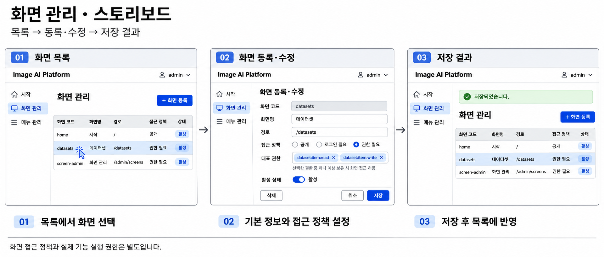

# 화면 관리 스토리보드

- 상태: 폐기 설계 이력 (2026-11-09, 기존 UI 모듈 철거)
- 작성일: 2026-11-09
- 버전: v1
- 범위: 화면 목록, 등록·수정, 저장 결과

## 스토리보드 이미지

## 화면 흐름

1. **화면 목록**: 화면 코드·이름·경로·접근 정책·활성 상태를 확인합니다. 기존 화면을 선택하거나 화면 등록을 시작합니다.
2. **화면 등록·수정**: 화면 코드·이름·경로, 접근 정책, 대표 권한과 활성 상태를 설정합니다. 수정 시 화면 코드는 변경하지 않는 구성입니다.
3. **저장 결과**: 저장 성공 안내와 갱신된 목록을 확인합니다.

## 접근 정책

- 공개: 인증 없이 화면 접근을 허용합니다.
- 로그인 필요: 인증된 활성 사용자에게 화면 접근을 허용합니다.
- 권한 필요: 대표 권한 중 하나 이상 보유한 활성 사용자에게 화면 접근을 허용합니다. 대표 권한이 비어 있으면 접근을 거부합니다.
- 화면 접근 정책과 실제 기능 실행 권한은 별개입니다. 이미지의 권한 코드는 예시이며 자동 등록을 뜻하지 않습니다.

## 설계 상태

이 이미지는 화면 구성을 검토하기 위한 초안입니다. 저장 성공 흐름을 중심으로 표현했으며 오류·삭제 확인 등 세부 상호작용을 모두 정의한 것은 아닙니다. 프런트엔드 구현 완료나 최종 UI 확정을 의미하지 않습니다. API와 데이터 제약은 아래 기준 문서를 따릅니다.

## 관련 문서

- [메뉴·화면 API](../api.md)
- [화면·메뉴 테이블 정의서](../tables/README.md)
- [서비스 권한 검사 경계](../../../decisions/ADR-026-service-permission-boundary.md)
- [전체 스토리보드 목록](../../../storyboards/README.md)
