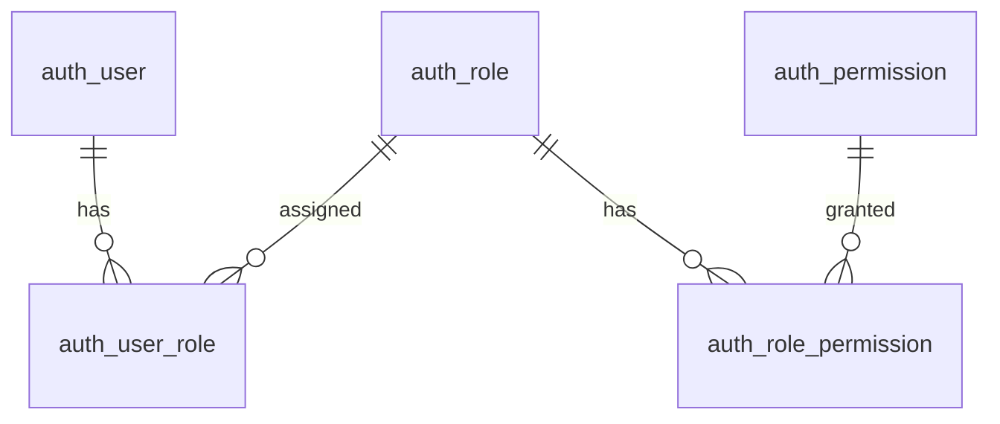

# 인증·권한 테이블

스키마 정의는 각 테이블 문서를 기준으로 관리합니다. 권한 테이블의 실제 MyBatis 조회 DAO를 구현했습니다. 공통 스키마는 기본 역할 할당을 만들지 않으며 local seed만 admin 계정·역할·권한 연결을 준비합니다. 사용자 식별은 user_key·user_id·username으로 분리했고 실제 이관은 V7→V8→V9를 따릅니다. 정책과 구현 순서는 [권한 설계 제안](../../../plans/authorization-design-proposal.md)에서 관리합니다.

| 테이블 | 상태 | 책임 |
|---|---|---|
| [auth_user](auth-user.md) | 구현됨 | 기존 로그인 계정 |
| [auth_role](auth-role.md) | 구현됨 | 역할 정의 |
| [auth_permission](auth-permission.md) | 구현됨 | 부여 가능한 권한 정의 |
| [auth_user_role](auth-user-role.md) | 구현됨 | 사용자 역할 할당 |
| [auth_role_permission](auth-role-permission.md) | 구현됨 | 역할 권한 할당 |

## 관계

## 공통 규칙과 적용 순서

- V5에서 모든 인증·권한 테이블에 [공통 컬럼](../../schema-rules.md)을 추가합니다. 시스템 작업자는 문자열 `'0'`이며 사용자 계정으로 사용할 수 없습니다.

- 데이터소스는 `app`입니다. 역할·권한 코드를 자연 키로 사용하고, 연결 테이블은 복합 PK로 중복을 막습니다.
- 코드는 대소문자를 구분해 정확히 비교합니다.
- 사용자 키는 `user_key VARCHAR(100)`이며 연결·JWT·감사 기록의 내부 참조입니다. `user_id`는 고유 로그인 아이디, `username`은 중복 가능한 실명입니다. V7→V8→V9 이관과 [ADR-031](../../../decisions/ADR-031-user-identity-fields.md)을 따릅니다.
- 부모 삭제·키 변경의 FK 동작은 `NO ACTION`이며 연쇄 삭제하지 않습니다. 연결 해제·삭제는 서비스 트랜잭션으로 처리합니다.
- 생성 순서는 기존 `auth_user` 확인 → `auth_role`·`auth_permission` → 두 연결 테이블입니다. 제거 순서는 역순입니다.
- 스키마 정의와 기본 역할·권한 데이터 확정은 구분합니다. `ADMIN`·`MEMBER` 및 실제 부여 권한은 정책 질의 결과를 반영한 뒤 별도로 관리합니다.
- 소유권·공유 범위, 권한 회수 동시성, 관리자 보호, 감사 이력은 이 네 테이블만으로 해결되지 않습니다. 관련 단계에서 별도로 설계합니다.

## DB 검증 항목

- FK와 복합 PK로 존재하지 않는 사용자·역할·권한 연결과 중복 연결을 거부하는지 확인합니다.
- 부모를 먼저 삭제하면 거부되고 연결 해제 후에는 삭제 가능한지 확인합니다.
- 복수 역할의 중복 권한을 제거한 합집합, 역할 없는 사용자의 빈 결과를 확인합니다.
- 코드 형식·길이·대소문자와 대상 DB의 인덱스 사용을 확인합니다.
- 실제 검증 결과와 DB 범위는 권한 설계 제안서의 DB 연결 단계에서 기록합니다. 운영 DB 검증과 구분합니다.
