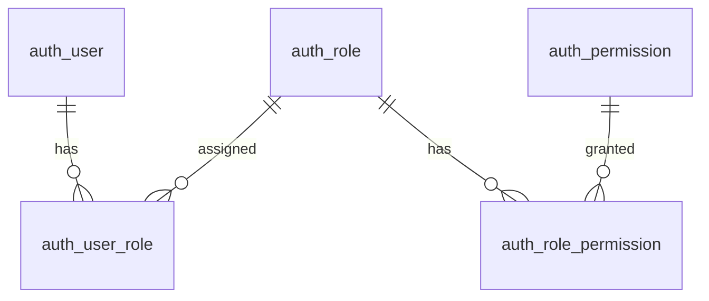

# 인증·권한 테이블

스키마 정의는 각 테이블 문서를 기준으로 관리합니다. 권한 테이블은 V2, 초기 역할과 감사 테이블은 V3, ADMIN의 사용자 관리 권한 연결은 V4로 관리합니다. 환경별 적용은 기존 Flyway 정책을 따릅니다. 초기 역할은 ADMIN·MEMBER이며 최초 관리자 계정은 별도 bootstrap 명령으로만 생성합니다. 정책과 구현 순서는 [권한 설계 제안](../../../proposals/authorization-design-proposal.md)에서 관리합니다.

| 테이블 | 상태 | 책임 |
|---|---|---|
| [auth_user](auth-user.md) | 구현됨, V1 | 기존 로그인 계정 |
| [auth_role](auth-role.md) | 구현됨, V2 | 역할 정의 |
| [auth_permission](auth-permission.md) | 구현됨, V2 | 부여 가능한 권한 정의 |
| [auth_user_role](auth-user-role.md) | 구현됨, V2 | 사용자 역할 할당 |
| [auth_role_permission](auth-role-permission.md) | 구현됨, V2 | 역할 권한 할당 |
| [auth_audit_log](auth-audit-log.md) | 구현됨, V3 | 사용자 역할 변경 감사 이력 |

## 관계

## 공통 규칙과 적용 순서

- 데이터소스는 `app`입니다. 역할·권한 코드를 자연 키로 사용하고, 연결 테이블은 복합 PK로 중복을 막습니다.
- 코드는 대소문자를 구분해 정확히 비교합니다. 대상 DB의 collation과 문자열 비교 규칙은 migration 작성 시 확인합니다.
- 기존 사용자 키는 `username VARCHAR(100)`입니다. 이번 정의에서 존재하지 않는 `user_id`를 참조하거나 기존 V1을 변경하지 않습니다. 불변 사용자 ID 전환은 auth_user 및 연결 테이블을 함께 바꾸는 별도 설계·migration으로 관리합니다.
- 부모 삭제·키 변경의 FK 동작은 `NO ACTION`이며 연쇄 삭제하지 않습니다. 연결 해제·삭제는 서비스 트랜잭션으로 처리합니다.
- 생성 순서는 기존 `auth_user` 확인 → `auth_role`·`auth_permission` → 두 연결 테이블입니다. 제거 순서는 역순입니다.
- V3는 `ADMIN`·`MEMBER`를 시스템 역할로 추가합니다. 같은 코드가 이미 있으면 기존 행을 유지합니다. ADMIN의 이름이나 시스템 역할 여부만으로 권한을 허용하지 않습니다.
- 소유권·공유 범위, 권한 회수 동시성, 관리자 보호는 역할 연결 테이블만으로 해결되지 않습니다. 감사 이력은 별도 auth_audit_log에 저장합니다.

## DB 검증 항목

- FK와 복합 PK로 존재하지 않는 사용자·역할·권한 연결과 중복 연결을 거부하는지 확인합니다.
- 부모를 먼저 삭제하면 거부되고 연결 해제 후에는 삭제 가능한지 확인합니다.
- 복수 역할의 중복 권한을 제거한 합집합, 역할 없는 사용자의 빈 결과를 확인합니다.
- 코드 형식·길이·대소문자와 대상 DB의 인덱스 사용을 확인합니다.
- 실제 검증 결과와 DB 범위는 권한 설계 제안서의 DB 연결 단계에서 기록합니다. 운영 DB 검증과 구분합니다.
