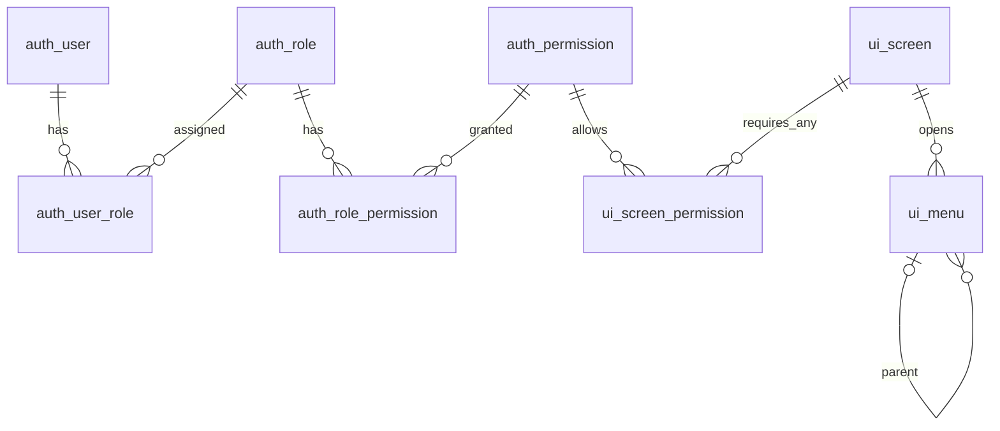

# 화면·메뉴 테이블 정의

## 기존 UI 모듈 철거 — 2026-11-09

[ADR-027](../../../decisions/ADR-027-remove-ui-module.md)에 따라 기존 화면·메뉴 API, 서비스·DAO·도메인·매퍼와 프런트 동적 내비게이션을 제거했습니다. 아래 기존 UI 구현·검증 내용은 과거 이력이며 현재 제공 기능이 아닙니다. 로그인·세션·로그아웃과 공통 레이아웃은 유지합니다. 새 메뉴 구현은 별도 작업이며 URL은 React 코드에서, 숨김은 메뉴 렌더링에서 관리합니다.

- 상태: 구현됨 — app V3 migration·DAO·서비스·API 작성, 환경별 DB 적용은 migration 설정에 따름
- 데이터소스: `app`
- 접두사: 화면·메뉴를 나타내는 `ui`

| 테이블 | 책임 |
|---|---|
| [ui_screen](ui-screen.md) | 화면 코드·경로·접근 정책 |
| [ui_menu](ui-menu.md) | 메뉴 트리·이름·정렬·화면 연결 |
| [ui_screen_permission](ui-screen-permission.md) | 화면을 열 수 있는 대표 권한 연결 |

## 접근 판정

- 메뉴에 역할을 직접 연결하지 않습니다. 사용자 → 역할 → 유효 권한 → 화면 접근 → 메뉴 표시 순서로 판단합니다. 역할 이름을 프런트 코드에 고정하지 않습니다.
- 공개 화면은 인증 없이, 비공개 인증 전용 화면은 활성 계정이면 접근 가능합니다. 세부 권한 화면은 연결된 대표 권한 중 하나 이상을 보유해야 합니다(ANY/OR). ALL·임의 조건식·와일드카드는 초기 범위에서 제외합니다.
- 세부 권한이 필요하지만 연결이 없는 화면은 거부합니다. 공개·인증 전용 화면에는 권한 연결을 만들지 않습니다.
- 비활성 화면·메뉴 및 비활성 상위 메뉴 아래 항목은 표시하지 않습니다. 그룹 메뉴는 표시 가능한 하위 화면 메뉴가 하나 이상 있을 때만 표시합니다.
- 메뉴가 없는 화면도 존재할 수 있습니다. 화면 접근 여부와 메뉴 노출 여부는 구분하며, 메뉴에 없다는 이유만으로 접근 불가로 판단하지 않습니다.
- 메뉴 숨김과 화면 진입 조건은 API 인가를 대체하지 않습니다. 화면 내부 버튼과 실제 API는 각각 필요한 작업 권한으로 검사합니다. 특정 데이터셋의 소유권·공유 범위도 별도입니다.

## 조회와 최초 로딩

- 화면에 모든 하위 API 권한을 연결하지 않고, 조회·작업 진입에 필요한 대표 권한만 연결합니다. 예를 들어 사용자 관리 화면은 `auth:user:read` 또는 `auth:user:manage`로 열 수 있습니다. 예시 권한은 실제 auth_permission에 정의된 뒤 연결해야 합니다.
- 사용자 유효 권한을 한 번 조회해 Set으로 만들고, 화면별 연결을 확인한 뒤 메뉴 트리를 한 번 순회하는 방식을 기본안으로 둡니다. 권한 수 P·화면 수 S·화면 연결 수 C·메뉴 수 M에 대해 평균 O(P+S+C+M)이며 메뉴마다 전체 권한을 반복 조회하지 않습니다.
- 메뉴별 DB 조회를 반복하지 않습니다. 메뉴·화면·권한 연결은 각각 일괄 조회하고, 필요한 경우 SQL EXISTS로 사용자에게 허용된 화면을 선별할 수 있습니다. 현재는 각 목록을 일괄 조회해 서버에서 계산합니다. SQL EXISTS 기반 최적화는 구현하지 않았습니다.
- 프런트 첫 로딩에는 허용 화면 목록과 parentMenuCode를 포함한 평면 메뉴 목록을 반환합니다. 캐시·사용자별 메뉴 결과 테이블은 만들지 않으며 다음 요청에서 현재 권한을 다시 조회합니다. 프런트 자동 갱신은 별도 구현 범위입니다.

## 데이터 무결성과 초기 범위

- 화면·메뉴 코드는 생성 후 변경하지 않는 소문자 영문·숫자·하이픈 코드이며 최대 100자입니다. 예: `admin-users`, `datasets`.
- FK의 삭제·키 변경은 NO ACTION입니다. 연결·하위 메뉴를 먼저 해제한 뒤 부모를 삭제합니다. 자동 연쇄 삭제는 하지 않습니다.
- 쓰기 서비스에서 부모가 그룹인지, 메뉴 트리에 순환이 없는지, 접근 정책과 권한 연결이 일치하는지 확인합니다. 기동 시 전수 검사기·자동 등록 기능은 만들지 않습니다.
- 초기 화면 경로는 `/admin/users`, `/datasets` 같은 프런트 내부 정적 경로를 사용합니다. 동적 상세 화면 경로·외부 URL 메뉴·아이콘·다국어·사용자별 메뉴 편집은 현재 정의에 포함하지 않습니다.
- 생성 순서는 기존 auth_permission 확인 → ui_screen → ui_screen_permission·ui_menu(부모 먼저)입니다. CHECK·FK·유일 제약은 V3에 작성했습니다. 운영 DB의 실행 계획·대규모 부하 검증은 아직 하지 않았습니다.
- 신규 UiApiTest 13개 포함 전체 58개 테스트를 통과했습니다. H2에서 CRUD·인가·계층·롤백·동시 순환 방지를 검증했으며 운영 DB 성능 검증과 구분합니다.
- API 계약과 요청 예시는 [메뉴·화면 API](../../../api/ui.md)를 참고하세요. 공통 db/seed/app/common/R__01_ui_permissions.sql은 ui:screen:manage·ui:menu:manage 권한 정의만 추가하며 같은 common 폴더의 R__02_ui_navigation.sql이 시작·관리 화면·메뉴를 등록합니다. 관리자 계정·역할 연결은 local seed에서만 생성합니다.
