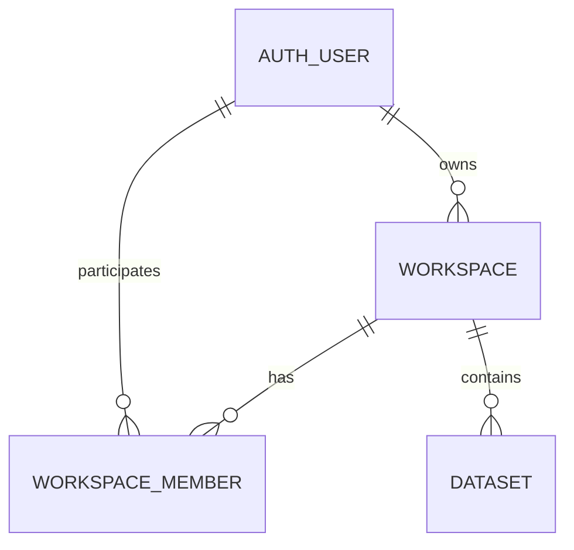

# 워크스페이스 테이블 설계

- 종류: 데이터 계약 설계
- 상태: V10·local 두 공간·가입 공간 조회 구현 — 관리 화면·가입 승인 API 미구현, 실제 DB 미적용
- 기준일: 2026-11-11
- 데이터소스: `app`
- 관련 결정: [ADR-032](../../../decisions/ADR-032-workspace-data-boundary.md)
- 업무 흐름·권한: [워크스페이스 설계 제안](../../../plans/workspace-design-proposal.md)

사용자는 여러 워크스페이스에 가입 신청하고 관리자의 승인을 받아 참여합니다. 데이터셋은 하나의 공간에 귀속하며 여러 공간을 선택하면 공간별 독립 데이터셋을 생성합니다. 생성자 개인의 탈퇴와 관계없이 유지합니다. 현재 구조는 [ADR-034](../../../decisions/ADR-034-independent-dataset-creation.md)를 따릅니다.

| 구분 | 테이블 | 책임 |
|---|---|---|
| 신규 | [workspace](workspace.md) | 공간 기본 정보·단일 소유자·운영 상태 |
| 신규 | [workspace_member](workspace-member.md) | 사용자별 가입 상태·승인 정보·공간 내 역할 |
| 귀속 | [dataset](../dataset/dataset.md) | 단일 공간 FK. 다중 선택은 공간별 독립 생성 |
| 재사용 | [auth_permission](../auth/auth-permission.md) 및 기존 RBAC | `dataset:item:read/create/use/update/delete` 기능 권한 |

## 권한 경계

기능 권한과 데이터 접근 범위를 분리합니다. 예를 들어 삭제는 서비스 `@PreAuthorize`에 `hasPermission('dataset:item:delete')`를 명시하고, ACTIVE 멤버십·활성 공간·대상 데이터셋의 공간 일치·공간 내 허용 정책을 AND로 검사합니다. OWNER나 ADMIN이라는 이유로 기능 권한 검사를 생략하지 않습니다. 공간 내 작업별 허용표는 아직 미확정입니다.

워크스페이스별 역할은 멤버십에 저장하며 기존 전역 `auth_user_role`에 공간별 역할을 복제하지 않습니다. 데이터셋별 사용자 ACL·별도 워크스페이스 권한 테이블은 이번 설계에 추가하지 않습니다.

## 도입 순서와 미정 사항

현재 V14~V16은 공유 연결을 제거하고 단일 공간 FK를 복원합니다. local V17은 과거 미귀속 데이터만 첫 번째 공통 공간으로 배정합니다. 아래 V10·V11~V13 설명은 이전 계획 이력입니다.

아래는 V10 단일 공간 설계의 이전 계획입니다. 현재는 [ADR-033](../../../decisions/ADR-033-dataset-multiple-workspaces.md)과 [연결 테이블 정의](../../../archive/dataset-sharing/dataset-workspace.md)가 이를 대체하며 dataset.workspace_id NOT NULL 단계는 진행하지 않습니다.

1. 신규 두 테이블과 `dataset.workspace_id`의 전환용 nullable 컬럼을 정의합니다.
2. 생성·가입·승인·소유자 이전 및 공간별 생성·조회 검사를 함께 구현합니다. 기존 공간 없는 API의 무제한 저장·조회가 계속되지 않게 계약을 전환합니다.
3. 기존 데이터셋의 대상 공간을 명시적으로 매핑합니다. 생성자의 가입 공간을 추정해 자동 배정하지 않습니다.
4. 누락·오귀속을 확인한 뒤 `dataset.workspace_id`를 NOT NULL로 전환합니다. 최종 스키마에는 미귀속 데이터셋을 허용하지 않습니다.

개설 가능 사용자, 가입 검색 공개 범위, 공간 내 작업별 허용 역할, 기존 데이터 귀속은 구현 전 확정해야 합니다. 재신청·소유자 표현 등 아래 세부 정책은 구현을 위한 설계안이며 사용자 확정 정책으로 간주하지 않습니다.

## SQL과 초기 데이터 구현

현재(2026-11-11 후속): local 공간 seed는 UUID 끝자리 001·002의 `공통 워크스페이스`, `공통 워크스페이스 2`를 등록합니다. 모두 admin 소유·ACTIVE ADMIN 멤버십이며 기존 행을 보존합니다. 가입 공간 조회 GET /api/workspaces와 다중 공간 데이터셋 목록·생성은 구현했습니다. 실제 DB 미적용이며 가입·승인·관리 기능은 후속입니다. 아래 V10 구현 기록과 구분합니다.

2026-11-11 사용자 승인으로 `db/migration/app/V10__create_workspaces.sql`에 신규 두 테이블·키·CHECK·인덱스와 dataset의 nullable 공간 FK를 정의했습니다. 상태 CHECK는 현재 H2에서 마이그레이션 연결 종료 후에도 평가할 수 있도록 CASE 표현으로 작성했습니다.

local 전용 `db/seed/app/local/R__local_workspace_seed.sql`은 기존 admin 계정 seed 뒤에 실행됩니다. `공통 워크스페이스`의 고정 UUID는 `00000000-0000-4000-8000-000000000001`이며 로그인 admin의 실제 내부 user_key를 찾아 소유자와 ACTIVE·ADMIN 멤버로 등록합니다. 생성·수정 작업자는 시스템 `'0'`입니다. 재실행해도 공간·멤버십을 중복 생성하거나 기존 정보·감사 값을 덮어쓰지 않습니다. common·test·dev·prod에는 이 공간을 생성하지 않습니다.

실제 로컬·운영 DB 적용과 서버 재시작은 하지 않았습니다. 관리 화면과 가입·승인·소유자 이전·데이터셋 공간 검사 API도 아직 없습니다. 기존 데이터셋과 생성 API는 workspace_id가 NULL일 수 있으며, 공간별 접근이 이미 적용된 것으로 간주하면 안 됩니다.

검증: Java 21에서 `mvn test "-Dtest=WorkspaceMigrationTest,LocalAppSeedTest"`의 3개 테스트 통과. V9 기존 데이터 보존, FK·중복 멤버·상태 CHECK, local admin의 소유자·관리자 등록과 재실행 보존을 확인했습니다. 전체 테스트는 실행하지 않았습니다.
