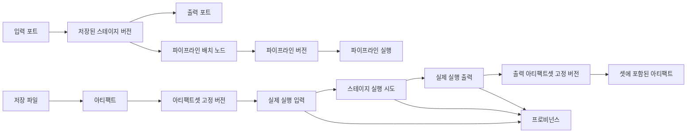

# 실행 파이프라인 설계 데이터 모델링

- 문서 종류: 설계 제안
- 상태: 초안·검토 중
- 작성일·갱신일: 2026-11-20
- 승인 범위: 데이터 모델링 문서 작성
- 논의 반영: 저장된 스테이지의 버전 재사용, 포트의 아티팩트셋 버전 통일, 상세 제약의 선택 적용
- 구현 상태: 미구현. 테이블·프로그램·실행 환경은 변경하지 않음
- 관련 문서: [현재 아키텍처](../architecture/architecture.md), [현재 API](../api/api.md), [공통 스키마 규칙](../db-schema/schema-rules.md), [기존 데이터셋 구조](../db-schema/tables/dataset/README.md)

## 문제와 목표

이미지 분석이나 모델 학습을 여러 단계로 나누어 실행합니다. 각 단계는 서로 다른 서버에서 수행될 수 있으며, 앞 단계의 산출물을 다음 단계의 입력으로 사용합니다.

이때 원본 파일이 교체되거나 실행이 실패해 다시 시도하더라도, 어떤 입력과 처리 조건으로 결과가 만들어졌는지 확인할 수 있어야 합니다.

핵심 엔티티는 **아티팩트, 아티팩트셋, 파이프라인, 스테이지, 프로비넌스, 스테이지 입력·출력**입니다. 여기에 버전, 실제 실행, 실행 시도, 파일 저장 정보를 연결합니다.

목표는 다음과 같습니다.

1. 원본과 중간·최종 산출물을 같은 원칙으로 식별하고 보관합니다.
2. 처리 단계의 정의와 실제 실행 기록을 구분합니다.
3. 실행에 사용한 데이터와 설정을 특정 버전으로 고정합니다.
4. 결과에서 원본까지 생성 경로를 역으로 추적합니다.
5. 처리 단계와 산출물 종류를 추가해도 기존 실행 기록의 의미가 바뀌지 않게 합니다.

## 범위와 제외 범위

이번 문서는 논리적인 엔티티, 주요 속성, 관계, 버전, 상태와 보존 규칙을 제안합니다. 실제 테이블 생성, 자료 이관, 화면, 실행 API, 작업 서버와 스케줄러 구현은 포함하지 않습니다.

NAS는 검토 중인 저장 방식으로 다룹니다. 제품 선정이나 운영 적용이 끝난 것으로 간주하지 않습니다. 데이터베이스 컬럼의 상세 형식과 길이, 실행 엔진, 큐, 처리 알고리즘은 후속 설계 대상입니다.

## 제안 설계

### 1. 핵심 엔티티

| 엔티티 | 역할 | 예시 |
|---|---|---|
| 아티팩트 | 식별 가능한 데이터의 고정 버전 | 원본 이미지, 임베딩, 모델, 평가 결과 |
| 아티팩트셋 | 목적에 따라 아티팩트를 묶은 집합 | 분석 입력셋, 학습셋, 검증셋 |
| 스테이지 | 재사용 가능한 처리 단위의 정의 | 이미지 크기 변경, 특징 추출 |
| 스테이지 입력 | 이름이 있는 아티팩트셋 입력 연결점 | 이미지셋, 모델 하나를 포함한 셋 |
| 스테이지 출력 | 이름이 있는 아티팩트셋 출력 연결점 | 전처리 이미지셋, 임베딩 하나를 포함한 셋 |
| 파이프라인 | 스테이지의 배치와 연결을 정의한 처리 흐름 | 전처리 → 특징 추출 → 군집 분석 |
| 프로비넌스 | 결과의 출처와 실제 생성 경로 | 사용한 원본 버전·처리기·설정·실행 시도 |

아카이브는 원본과 산출물을 보존하는 책임으로 정의합니다. 초기에는 별도 업무 엔티티나 서비스로 나누지 않고 아티팩트의 파일·보관 기한·보호 여부로 표현합니다. 저장소의 폐기 문서 폴더나 기존 아카이브 데이터베이스와는 다른 개념입니다.

중간 산출물과 최종 산출물은 사용 맥락으로 구분합니다. 같은 임베딩이 한 실행의 최종 결과이면서 다른 실행의 입력일 수 있으므로, 이를 고정된 아티팩트 종류로 나누지 않습니다.

### 2. 전체 관계



스테이지 정의와 파이프라인에 배치한 노드는 구분합니다. 같은 크기 변경 스테이지를 한 파이프라인에서 두 번 사용하더라도, 각 노드에 다른 크기 설정을 지정할 수 있습니다.

### 3. 공통 식별·감사 규칙

모든 테이블에 생성일시·수정일시·생성자·수정자를 필수로 둡니다. 버전, 구성 항목, 입출력 연결과 출처 기록도 예외가 아닙니다.

| 항목 | 저장 규칙 |
|---|---|
| 생성일시·수정일시 | 시간대가 있는 타임스탬프. 컬럼명은 created_at·updated_at |
| 생성자·수정자 | 내부 사용자 키 또는 시스템 값 '0'. 컬럼명은 created_by·updated_by |
| 신규 식별자 | 서버가 발급한 UUID |
| 버전 번호 | 동일한 논리 대상 안에서 증가 |
| 실행 시작·종료 시각 | 공통 감사 시각과 별도로 저장 |
| 원본 등록 정보 | 새 기록의 생성일로 덮어쓰지 않고 출처 스냅샷에 보존 |

자세한 자료형과 작업자 규칙은 공통 스키마 규칙을 따릅니다. 자바 자료 모델은 래퍼 타입을 사용하고 필수값은 별도로 검증합니다.

### 4. 아티팩트와 저장 파일

| 엔티티 | 주요 속성 | 식별·제약 |
|---|---|---|
| 아티팩트 | 식별자, 소속 공간, 데이터 종류, 스키마 이름·버전(선택), 상태, 설명 정보, 보관 기한, 보호 여부 | 식별자 하나가 내용의 고정 버전 하나를 의미 |
| 아티팩트 파일 | 식별자, 아티팩트 식별자, 내부 이름, 저장 루트 키, 상대 경로, 형식, 크기, 체크섬 방식·값, 실체 삭제 시각 | 같은 아티팩트 안에서 내부 이름은 고유 |

하나의 아티팩트는 파일 하나 또는 여러 파일로 저장할 수 있습니다. 예를 들어 모델 아티팩트는 가중치·설정·토크나이저 파일을 함께 포함할 수 있습니다. 파일 개수와 아티팩트 개수는 같은 의미가 아닙니다.

데이터 종류는 이미지·임베딩·라벨·모델·평가 지표·목록 파일·일반 바이너리 등으로 설명합니다. 구조를 명시해야 하는 아티팩트는 스키마 이름과 버전을 기록할 수 있지만, 모든 일반 파일에 스키마 등록을 요구하지 않습니다. 임베딩 차원이나 자료형 등 처리에 필요한 정보는 처리기와 함께 정의합니다. 큰 배열과 대량 항목 목록은 데이터베이스의 설명 속성에 넣지 않고 파일로 보관합니다.

내부 이름은 아티팩트 안의 논리적인 이름입니다. 실제 저장 위치는 저장 루트 키와 상대 경로로 구분합니다. 저장 루트 키를 각 서버의 설정에서 해석하므로 특정 서버의 드라이브 문자나 절대 마운트 경로를 데이터베이스에 고정하지 않습니다.

기록 중에는 크기·체크섬이 미확정일 수 있습니다. 이용 가능 상태로 확정하기 전에는 필요한 파일의 정보와 검증값을 모두 채워야 합니다. 확정된 내용은 수정하지 않고 새 아티팩트를 생성합니다. 원본명으로 파일을 덮어쓰거나 체크섬만으로 공간 간 파일을 자동 공유하지 않습니다.

### 5. 아티팩트셋과 버전

| 엔티티 | 주요 속성 | 식별·제약 |
|---|---|---|
| 아티팩트셋 | 식별자, 소속 공간, 이름, 목적, 설명 | 논리적인 집합의 식별 단위 |
| 아티팩트셋 버전 | 식별자, 셋 식별자, 버전 번호, 상태, 항목 수, 구성 체크섬, 확정 시각 | 같은 셋 안에서 버전 번호는 고유 |
| 아티팩트셋 구성 항목 | 셋 버전 식별자, 아티팩트 식별자, 순서, 원본 대응 키 | 같은 셋 버전에 같은 아티팩트와 순서를 중복 등록하지 않음 |

셋의 목적은 원본 입력·학습·검증·분석 결과 등입니다. 확정된 버전의 항목과 순서는 바꾸지 않습니다. 추가·제거·원본 교체가 필요하면 새로운 셋 버전을 만듭니다.

실행은 셋의 현재 상태가 아니라 특정 셋 버전을 사용합니다. 동일한 아티팩트를 여러 셋에 포함해도 파일을 다시 복사하지 않습니다. 초기 모델에서 셋 안에 셋을 중첩하지 않습니다.

모든 입력·출력 포트는 아티팩트셋 버전으로 통일합니다. 모델 하나도 항목이 한 개인 셋으로 전달합니다. 포트 연결마다 개별 아티팩트와 셋을 나누어 처리하지 않습니다. 항목 수는 셋에 포함된 아티팩트 개수이며, 파일 수나 아티팩트 내부의 데이터 행 수가 아닙니다.

원본 대응 키와 매니페스트, 즉 파일 구성·항목 대응을 기록한 목록을 통해 원본 이미지와 임베딩의 대응을 보존합니다. 파일의 행 번호만으로 원본을 식별하지 않습니다. 반복 샘플링과 가중치는 셋 항목을 중복 저장하기보다 별도 실행 조건으로 표현합니다.

### 6. 스테이지와 입력·출력 계약

| 엔티티 | 주요 속성 | 식별·제약 |
|---|---|---|
| 스테이지 | 식별자, 소속 공간, 이름, 설명 | 재사용할 처리 단위의 논리적인 이름 |
| 스테이지 버전 | 식별자, 스테이지 식별자, 버전 번호, 공개 상태, 처리기 이름·버전, 코드 고정 식별값, 실행 환경 명세, 매개변수 형식·기본값 | 같은 스테이지 안에서 버전 번호는 고유 |
| 스테이지 입력 | 식별자, 스테이지 버전, 입력 이름, 설명, 필수 여부, 선택 제약 | 같은 스테이지 버전 안에서 입력 이름은 고유. 전달 대상은 아티팩트셋 버전 |
| 스테이지 출력 | 식별자, 스테이지 버전, 출력 이름, 설명, 선택 제약 | 같은 스테이지 버전 안에서 출력 이름은 고유. 전달 대상은 아티팩트셋 버전 |

#### 포트의 의미와 기본 설정

포트는 데이터를 주고받는 이름 있는 연결점입니다. 포트 정의는 전달 위치를 설명하고 실제 데이터는 연결된 아티팩트셋의 고정 버전입니다. 네트워크 포트 번호와는 관계가 없습니다.

포트 하나는 셋 버전 하나를 받거나 제공합니다. 여러 아티팩트는 셋의 구성 항목으로 전달합니다. 파이프라인 외부 입력과 최종 출력도 같은 원칙을 사용합니다.

| 설정 | 기본 정책 |
|---|---|
| 포트 이름 | 필수. 같은 스테이지 버전의 같은 방향에서 고유 |
| 설명 | 용도를 알 수 있도록 제공하되 작성은 선택 |
| 입력 필수 여부 | 스테이지 작성자가 지정. 필수 입력을 연결하지 않으면 실행할 수 없음 |
| 전달 대상 | 아티팩트셋의 고정 버전으로 공통 적용. 사용자에게 대상 종류를 다시 선택시키지 않음 |
| 허용 아티팩트 종류 | 선택. 미지정하면 포트 계층에서 종류를 제한하지 않음 |
| 스키마 | 선택. 필요한 처리기에서만 구체적인 내용 구조를 지정 |
| 최소·최대 항목 수 | 선택. 미지정하면 포트 계층에서 개수를 제한하지 않음 |

필수 입력이라는 뜻은 셋 버전이 연결돼야 한다는 의미입니다. 비어 있는 셋을 금지한다는 뜻은 아닙니다. 최소 항목 수가 필요한 처리기만 별도 조건을 둡니다. 모든 포트에 종류·스키마·개수 제약을 의무적으로 입력하게 하지 않습니다.

#### 제약과 검증 책임

스테이지 작성자가 처리에 필요한 제약을 선언하면 해당 스테이지 버전에 보관하고, 파이프라인에서 재사용할 때 함께 불러옵니다. 노드를 배치할 때마다 사용자가 같은 제약을 다시 설정하지 않습니다. 초기에는 노드마다 포트 제약을 따로 덮어쓰는 기능을 두지 않습니다.

연결 시에는 포트 존재, 소속, 공급원 중복을 확인하고 선택 제약이 명백히 충돌하면 알려줍니다. 제약을 생략한 포트를 이유 없이 연결 불가로 취급하거나, 제약이 없다는 이유로 실제 데이터가 호환된다고 보장하지 않습니다. 처리에 필요한 실제 파일 형식·구조는 처리기가 실행 시 확인하고 실패 원인을 반환합니다. 필수 입력 누락과 확인 가능한 계약 위반은 실행 전에 거부합니다.

예를 들어 특징 추출 스테이지의 기본 입력은 이미지셋·기준 모델셋, 출력은 임베딩셋으로 정의할 수 있습니다. 기본 설정은 포트 이름과 입력 필수 여부만으로 시작합니다. 모델이 정확히 하나 필요한 처리기라면 그 처리기가 조건을 선언하거나 실행 시 검증합니다. 임베딩 768차원 같은 조건은 모든 포트의 공통 의무 설정이 아닙니다.

임베딩 아티팩트 하나에 이미지 1,000개의 벡터를 담고, 출력 셋에는 그 아티팩트 하나를 넣을 수 있습니다. 따라서 셋 항목 수 1개는 벡터 1개를 뜻하지 않습니다. 입력 이미지마다 결과가 하나씩 있어야 한다는 조건은 별도의 항목 대응 규칙입니다.

#### 저장된 스테이지 재사용

공개된 스테이지 버전과 입출력 계약은 변경하지 않습니다. 코드·처리 방식·내용 구조가 바뀌면 새로운 버전을 만듭니다. 실행 배포물은 바뀔 수 있는 최신 태그 대신 고정 식별값으로 기록합니다.

파이프라인 노드는 저장된 스테이지의 특정 버전을 참조합니다. 스테이지 정의를 복사해 별도 수정본을 만들지 않습니다. 같은 버전을 여러 파이프라인과 같은 파이프라인의 여러 노드에서 사용할 수 있으며 노드마다 실행 매개변수만 다르게 지정합니다.

```text
저장된 이미지 크기 변경 스테이지 1번 버전
  ├─ 파이프라인 A의 노드 1: 224×224
  ├─ 파이프라인 A의 노드 2: 128×128
  └─ 파이프라인 B의 노드 1: 512×512
```

새 스테이지 버전을 공개해도 기존 노드의 참조는 자동 변경하지 않습니다. 새 버전을 적용할 때는 파이프라인의 새 정의 버전에서 명시적으로 선택합니다. **스테이지 재사용은 처리 정의 재사용**이며 이전 실행 결과를 자동 재사용하는 캐시와는 별개입니다. 결과 캐시는 이번 설계에 추가하지 않습니다.

### 7. 파이프라인 구성

| 엔티티 | 주요 속성 | 식별·제약 |
|---|---|---|
| 파이프라인 | 식별자, 소속 공간, 이름, 설명 | 처리 흐름의 논리적인 이름 |
| 파이프라인 버전 | 식별자, 파이프라인 식별자, 버전 번호, 공개 상태, 정의 체크섬, 공개 시각 | 같은 파이프라인 안에서 버전 번호는 고유 |
| 파이프라인 노드 | 식별자, 파이프라인 버전, 노드 이름, 스테이지 버전, 매개변수 재정의 | 같은 파이프라인 버전 안에서 노드 이름은 고유 |
| 파이프라인 연결 | 식별자, 파이프라인 버전, 출발 노드·출력, 도착 노드·입력 | 도착 입력 하나에는 공급원 하나만 허용 |
| 파이프라인 입력 | 식별자, 파이프라인 버전, 이름, 설명, 필수 여부, 선택 제약 | 사용자가 실행할 때 제공하는 외부 입력. 대상은 아티팩트셋 버전 |
| 파이프라인 입력 연결 | 파이프라인 입력, 도착 노드, 스테이지 입력 | 외부 입력 하나를 여러 노드에 전달 가능 |
| 파이프라인 출력 | 식별자, 파이프라인 버전, 이름, 출발 노드·출력 | 실행의 최종 결과로 노출할 출력 선택 |

두 노드를 연결할 때는 각각의 스테이지 버전에 속한 포트인지 확인합니다. 외부 입력과 앞 단계의 출력을 같은 포트에 중복 연결하지 않습니다. 같은 출력을 여러 노드에 전달하는 것은 허용합니다.

초기 흐름은 순환이 없는 방향 그래프입니다. 필수 상위 출력이 모두 준비된 뒤 다음 노드를 실행합니다. 조건 분기·반복·동적 노드 생성·데이터 전달 없는 제어 연결은 후속 설계로 남깁니다.

최종 출력으로 지정되지 않은 결과도 아티팩트로 보관할 수 있습니다. 모든 중간 결과를 기존 데이터셋에 자동 등록하지는 않습니다.

### 8. 실제 실행과 재시도

| 엔티티 | 주요 속성 | 식별·제약 |
|---|---|---|
| 파이프라인 실행 | 식별자, 소속 공간, 파이프라인 버전, 요청자, 상태, 실제 매개변수, 환경 정보, 시작·종료 시각 | 실행 요청 한 건을 식별 |
| 파이프라인 실행 입력 | 실행, 파이프라인 입력, 아티팩트셋 버전 식별자 | 입력 포트마다 실제 셋 버전 하나를 고정 |
| 스테이지 실행 | 식별자, 파이프라인 실행, 노드, 상태, 실제 매개변수, 채택한 실행 시도 | 같은 실행 안에서 노드마다 한 건 |
| 스테이지 실행 시도 | 식별자, 스테이지 실행, 시도 번호, 상태, 작업 서버, 할당 토큰·기한, 시작·종료 시각, 오류 정보 | 재시도마다 새 기록을 생성 |
| 실행 시도 입력 | 식별자, 실행 시도, 스테이지 입력, 실제 아티팩트셋 버전 식별자 | 같은 시도의 같은 입력 포트에 한 건 |
| 실행 시도 출력 | 식별자, 실행 시도, 스테이지 출력, 생성한 아티팩트셋 버전 식별자 | 같은 시도의 같은 출력 포트에 한 건 |

정의상의 입력·출력과 실제 전달된 입력·출력은 다른 엔티티입니다. 실제 입출력은 아티팩트셋 버전 식별자 하나로 통일합니다. 개별 아티팩트 참조 컬럼과 대상 종류 구분 컬럼을 포트 바인딩에 따로 두지 않습니다. 필수 입력에는 바인딩이 반드시 있어야 하며 선택 입력은 바인딩이 없을 수 있습니다. 필수가 아닌 것과 빈 셋을 연결한 것은 구분해서 기록합니다.

입력은 이용 가능한 아티팩트들로 구성된 확정 셋 버전만 사용합니다. 앞 단계의 출력은 채택된 성공 시도의 결과 셋으로 고정합니다. 실패한 시도의 미완성 파일을 다음 단계가 읽지 않게 합니다.

재시도는 새로운 시도 식별자와 저장 경로를 사용합니다. 입력·정의·매개변수 자체를 바꾸려면 별도 파이프라인 실행으로 구분합니다. 기본값과 노드 설정, 사용자 입력을 합친 실제 매개변수를 실행 기록에 보존합니다.

실행 요청자, 작업 서버, 데이터베이스 변경 작업자는 구분합니다. 시스템이 상태를 갱신해도 최초 요청 사용자 정보는 유지합니다.

### 9. 프로비넌스

| 엔티티 | 주요 속성 | 식별·제약 |
|---|---|---|
| 프로비넌스 | 식별자, 소속 공간, 대상 아티팩트 또는 셋 버전, 출처 종류, 생성한 실행 시도 출력, 원본 출처 스냅샷, 항목 대응 파일 | 대상마다 생성 출처 하나를 기록 |
| 프로비넌스 입력 연결 | 프로비넌스, 실제 실행 시도 입력 | 결과 생성에 사용한 입력 기록을 연결 |

출처 종류는 다음과 같습니다.

- **가져오기**: 기존 데이터셋이나 외부에서 가져온 아티팩트입니다. 원본 데이터셋·파일 식별자, 원본 버전, 상대 이름과 감사 정보를 스냅샷으로 기록합니다.
- **실행 생성**: 스테이지가 만든 출력 셋 버전과 그 안의 새 아티팩트입니다. 생성한 실제 출력 기록과 사용한 입력 기록을 연결합니다. 출력 바인딩은 셋 버전을 가리키며, 개별 결과의 프로비넌스 대상은 해당 출력 셋의 구성원이어야 합니다. 입력이 없는 생성 단계도 허용합니다. 셋에 그대로 재사용한 기존 아티팩트는 원래 출처를 유지합니다.
- **셋 구성**: 사용자가 아티팩트를 모아 확정한 셋 버전입니다. 계보는 변경할 수 없는 구성 항목으로 연결하며 원본 파일을 새로 생성했다는 의미는 아닙니다.

입력 셋·출력 셋은 실제 실행 입출력에 저장하고, 프로비넌스는 해당 기록을 참조합니다. 사용한 개별 아티팩트는 고정된 셋 구성에서 찾으며 같은 입력 대상 목록을 여러 곳에 복제하지 않습니다. 정의상의 연결만 보고 실제 사용한 입력이라고 기록하지 않습니다.

일부 입력만 사용한 출력은 실제 사용한 입력만 연결합니다. 이미지·벡터 행 단위의 세부 대응은 고정된 항목 대응 파일에 기록할 수 있습니다. 이 파일이 결과 파일 또는 셋의 확정 매니페스트에 속하는 구체적인 저장 관계는 물리 설계에서 확정합니다.

```text
군집 결과
  → 생성 출처
  → 실제 군집 실행 시도와 매개변수
  → 실제 입력인 임베딩셋의 고정 버전
  → 해당 셋에 포함된 임베딩
  → 임베딩을 만든 실행 시도
  → 전처리 결과
  → 입력 아티팩트셋의 고정 버전
  → 원본 아티팩트와 원본 파일 버전
```

### 10. 상태와 결과 확정

| 대상 | 상태 흐름 | 주요 규칙 |
|---|---|---|
| 정의 버전 | 작성 중 → 공개 | 공개 내용은 불변 |
| 아티팩트셋 버전 | 작성 중 → 확정 | 확정 후 구성 변경 금지 |
| 파이프라인 실행 | 대기 → 실행 중 → 성공·실패·취소 | 취소 요청과 취소 완료는 구분 |
| 스테이지 실행 | 상위 결과 대기 → 실행 가능 → 실행 중 → 성공·실패·취소 | 시도 실패와 스테이지 최종 실패를 구분 |
| 실행 시도 | 대기 → 실행 중 → 성공·실패·취소·시간 초과 | 종료된 시도를 재개하지 않음 |
| 아티팩트 | 기록 중 → 이용 가능·실패, 이용 가능 → 삭제 대기 → 실체 삭제 완료 | 미완성 결과는 입력으로 사용 금지 |

결과 확정은 다음 순서로 설계합니다.

1. 시도별 고유 경로에 파일을 작성하고 닫습니다.
2. 파일 목록·크기·체크섬과 선언된 선택 제약, 처리기별 필수 조건을 검증합니다. 선언되지 않은 종류·스키마·항목 수 제약을 플랫폼에서 임의로 부과하지 않습니다.
3. 유효한 시도와 할당 토큰인지, 취소되지 않았는지 확인합니다.
4. 한 데이터베이스 트랜잭션에서 아티팩트 이용 가능 상태, 출력 셋 확정, 실제 출력·계보·시도 성공·채택 결과를 함께 확정합니다. 완료에 필요한 출력을 일부만 공개하지 않습니다.
5. 다음 단계는 확정된 결과의 식별자를 받아 실행합니다. 작업 메시지에는 큰 파일 자체를 넣지 않습니다.

파일 저장과 데이터베이스 갱신은 하나의 트랜잭션이 아닙니다. 파일만 저장되고 확정이 실패한 경우를 미공개 파일로 식별해야 합니다. 미완료 파일과 고아 파일 정리는 후속 구현 과제입니다.

같은 완료 통지가 반복돼도 결과를 중복 등록하지 않습니다. 시간 초과된 이전 작업 서버는 만료된 할당 토큰으로 결과를 채택할 수 없습니다. 계산이 중복 수행되더라도 논리적으로 채택하는 결과는 하나입니다.

### 11. 기존 데이터셋과 보존 정책

기존 데이터셋은 업로드·권한·관리 화면의 업무 단위로 유지합니다. 실행 입력을 구성할 때 특정 이미지·데이터 파일 버전을 원본 아티팩트로 등록하고, 그 아티팩트들을 묶어 셋 버전을 확정합니다. 기존 데이터셋을 즉시 개명하거나 자동 이관하지 않습니다.

현재 데이터셋 삭제는 하위 파일 버전 행도 삭제합니다. 따라서 원본 행을 참조하는 것만으로 입력을 보전할 수 없습니다. 출처 스냅샷과 아티팩트 파일 정보를 별도로 유지하고, 기존 파일의 삭제를 막거나 관리 영역에 고정 복사하는 방식을 선택해야 합니다.

초기 검토안은 고정 버전 참조와 삭제 보호입니다. 이를 구현하려면 기존 삭제와 향후 실체 삭제 처리가 실행 입력의 참조를 함께 확인해야 합니다. 현재의 논리 삭제와 파일 보관만으로 이 기능이 완성됐다고 간주하지 않습니다.

보관 기한은 삭제 후보를 검토하는 시각입니다. 보호 지정, 진행 중인 실행, 확정 셋, 재시도, 재현·감사 보관 조건을 확인하기 전에 파일을 제거하지 않습니다. 같은 물리 파일을 여러 대상이 참조하면 전체 참조를 확인합니다.

삭제는 신규 참조 차단·삭제 대기 확정 → 파일 삭제 → 삭제 완료 기록으로 진행합니다. 참조 추가와 삭제 판정이 엇갈리지 않도록 경쟁을 제어합니다. 실체가 삭제돼도 식별자·스키마·체크섬·생성 출처와 입출력 관계는 남깁니다.

### 12. 관계 제약과 확장 원칙

- 정의·실행·입력·결과는 같은 워크스페이스에 속해야 합니다. 공간 간 공유는 초기 범위에서 제외합니다.
- 노드가 사용하는 스테이지 버전과 입출력 포트의 소속이 일치해야 합니다.
- 실행 노드는 해당 실행이 참조하는 파이프라인 버전에 속해야 합니다.
- 채택한 시도는 해당 스테이지 실행의 성공 시도여야 합니다.
- 입력 대상과 출력 대상은 모두 확정된 아티팩트셋 버전이어야 합니다.
- 프로비넌스의 대상은 연결한 실제 출력 셋 버전 또는 그 셋에서 새로 생성된 구성 아티팩트여야 합니다.
- 순환·자기 연결·필수 입력 누락·중복 공급원은 정의 공개나 실행 접수 때 업무 규칙으로 거부합니다. 명시된 선택 제약의 명백한 충돌은 연결 시 확인하고 실제 데이터의 처리 가능 여부는 처리기가 검증합니다.
- 실행이 참조한 정의·확정 셋·계보를 부모 삭제에 연쇄 삭제하지 않습니다.

이 구조로 같은 스테이지의 여러 노드 재사용, 새 입출력 계약 버전, 새 데이터 형식과 파이프라인 조합을 확장합니다. 자동 캐시, 전역 중복 제거, 동적 분기, 공간 간 공유는 필요가 확인된 뒤 별도 설계합니다.

### 13. 구현 식별자 대응

문서의 설명은 한국어를 기준으로 하며, 다음 영문은 향후 테이블 이름 후보입니다. 실제 테이블 생성 여부와 상세 분리는 승인 후 확정합니다.

| 한국어 엔티티 | 테이블 이름 후보 |
|---|---|
| 아티팩트·아티팩트 파일 | artifact · artifact_file |
| 아티팩트셋·버전·구성 항목 | artifact_set · artifact_set_version · artifact_set_member |
| 스테이지·스테이지 버전 | stage · stage_version |
| 스테이지 입력·출력 | stage_input · stage_output |
| 파이프라인·파이프라인 버전 | pipeline · pipeline_version |
| 파이프라인 노드·연결 | pipeline_node · pipeline_edge |
| 파이프라인 입력·입력 연결·출력 | pipeline_input · pipeline_input_binding · pipeline_output |
| 파이프라인 실행·실행 입력 | pipeline_run · pipeline_run_input |
| 스테이지 실행·실행 시도 | stage_run · stage_attempt |
| 실행 시도 입력·출력 | stage_attempt_input · stage_attempt_output |
| 프로비넌스·프로비넌스 입력 연결 | provenance · provenance_input |

## 대안과 장단점

| 비교 대상 | 장점 | 제안 방향 |
|---|---|---|
| 스테이지를 파이프라인 노드에 직접 포함 | 테이블이 적음 | 재사용과 독립적인 버전 관리를 위해 스테이지 정의와 배치 노드를 분리 |
| 입력과 출력을 방향 구분 하나로 통합 | 중복 구조를 줄임 | 공급·수신 계약과 참조 제약을 명확하게 하도록 입력·출력 엔티티를 분리 |
| 실행 기록만으로 계보 계산 | 별도 계보 기록이 적음 | 가져오기·셋 구성·실행 생성의 공통 탐색 진입점으로 프로비넌스를 명시 |
| 중간 결과를 모두 기존 데이터셋에 등록 | 기존 화면 활용이 쉬움 | 아티팩트로 관리하고 필요한 결과만 셋 구성·데이터셋 등록으로 연결 |
| 실행마다 원본 전체 복사 | 실행 입력의 물리적인 독립성이 높음 | 용량·전송 부담과 참조 보호 방식을 비교한 뒤 결정 |

## 보안과 운영

사용자의 조회·실행에는 기능 권한과 실제 활성 공간 멤버십을 함께 검사합니다. 기존 파일 읽기 권한이 파이프라인 실행이나 결과 조회 권한까지 자동 의미하지 않습니다. 권한 이름과 초기 부여 정책은 후속 결정입니다.

요청 사용자와 작업 서버의 인증을 구분합니다. 공유 NAS의 운영체제 권한만으로 업무 권한이 보장되지는 않으므로 작업 서버가 접근할 입력·출력 범위와 격리 방식을 함께 정해야 합니다.

NAS 연결이 끊겼을 때 같은 이름의 로컬 경로에 저장되는 상황을 피해야 합니다. 공유 파일과 데이터베이스를 복원 가능한 시점으로 맞춰 백업합니다. 저장소 선정과 운영 절차가 채택되면 [배포 문서](../operations/deployment.md)를 함께 갱신합니다.

## 구현 및 검증 계획

| 순서 | 작업 | 완료 조건 |
|---|---|---|
| 1 | 핵심 엔티티와 책임 검토 | 아티팩트·셋·스테이지·입출력·계보 의미 합의 |
| 2 | 전처리·특징 추출·분석 또는 학습 사례 대입 | 실제 입출력과 항목 대응을 정의 가능 |
| 3 | 원본 보전·보관·삭제 정책 결정 | 데이터셋 삭제와 실행 입력 보전이 충돌하지 않음 |
| 4 | 물리 테이블 설계 | 공통 감사·버전·고유성·소속·참조 조건 확정. 포트 입출력은 셋 버전 참조 하나로 단순화 |
| 5 | 단일 스테이지 실행 후 분산 연결 | 고정 입력·결과 일괄 확정·재시도·계보 역추적 성립 |

향후 필수 검증은 원본 변경 후 입력 고정, 같은 스테이지의 반복 배치, 기존 실행과 새 정의 버전의 분리, 미완성 출력 비공개, 중복 완료와 취소 경쟁, 실제 입력에 기반한 계보, 사용 중 파일의 삭제 방지입니다. 구현 시 필요한 검증만 최소한으로 수행합니다.

## 결정 및 결과

큰 주제는 **실행 파이프라인 설계**입니다. 사용자가 제시한 핵심 엔티티를 바탕으로 논리 모델과 확장 방향을 정리했습니다. 상세 엔티티 분리와 정책은 검토안이며 문서 작성이 전체 구현 승인을 뜻하지 않습니다.

2026-11-20 후속 논의는 다음과 같이 반영했습니다.

- 저장된 스테이지의 특정 버전을 참조하여 여러 파이프라인·노드에서 재사용합니다. 새 버전은 기존 파이프라인에 자동 적용하지 않습니다.
- 포트는 이름이 있는 아티팩트셋 입출력으로 단순화합니다. 개별 아티팩트는 셋의 구성 항목에서 관리하고 실제 실행은 고정된 셋 버전만 참조합니다.
- 허용 종류·스키마·최소·최대 항목 수는 모든 포트의 필수 설정이 아닙니다. 필요한 처리기만 선언하거나 실행 시 검증하고, 파이프라인 구성자가 같은 조건을 반복 입력하지 않습니다.
- 제약을 생략하는 것과 실제 처리 가능성을 보장하는 것은 구분합니다. 파일 읽기와 처리에 필요한 조건은 처리기의 책임으로 남깁니다.
- 포트와 실행 입력의 종류 선택·이중 참조 구조, 의무적인 상세 계약 설정을 전제로 한 기존 초안 설명은 위 단순화 방향으로 대체했습니다.

다음 검토 대상은 원본 보전 방식, 셋 폐기·보호 해제, 입출력 계약의 상세 구조, 항목 단위 계보, 실행 권한과 재시도 정책입니다. 채택된 중요한 결정은 ADR로 기록하고 실제 구현 시 DB·API·아키텍처 기준 문서를 갱신합니다.
