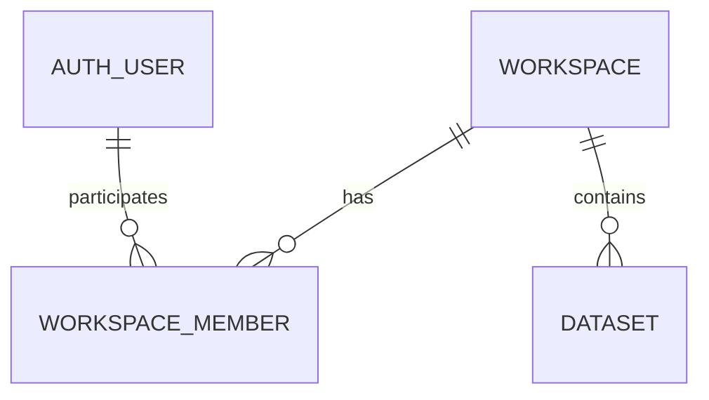

# 설계 제안: 워크스페이스 가입 승인과 데이터셋 접근 범위

- 종류: 설계 제안
- 상태: 검토 중 — 구현 승인 전
- 작성일: 2026-11-10
- 담당: 사용자 검토 · 개발 agent 정리
- 관련 문서: [데이터셋 작업계획서](dataset-development-plan.md), [권한 설계 제안](authorization-design-proposal.md), [현재 데이터셋 계약](../api/api.md), [공통 스키마 규칙](../db-schema/schema-rules.md)

## 문제와 목표

사용자는 여러 그룹 중 가입할 곳을 선택하고, 해당 그룹 관리자의 승인을 받아 참여한다. 데이터셋은 생성자 개인이 아니라 참여한 그룹을 기준으로 함께 조회한다. 이 요구는 단순 사용자 분류보다 데이터와 업무를 공유하는 공간에 해당하므로 제품 용어로 **워크스페이스**를 제안한다.

`워크스페이스`는 협업·데이터 접근의 경계, `멤버`는 그 공간에 승인되어 참여한 사용자다. 회사·기관 자체를 표현하는 `조직`이나 단순 사용자 묶음인 `그룹`과 구분한다. 당장은 별도 조직 계층이나 워크스페이스 하위 그룹을 만들 필요가 없다.

목표는 여러 워크스페이스 가입, 관리자 승인, 현재 워크스페이스 전환, 워크스페이스별 데이터셋 격리다. **아래 모델·역할·API는 제안이며 현재 구현 계약이 아니다.**

## 범위와 제외 범위

- 검토 범위: 가입 신청·승인, 멤버 역할, 데이터 귀속, 조회·생성의 접근 검사, 기존 데이터 전환과 개발 순서.
- 이번 작업: 진행 중이던 생성자 기준 목록 구현을 롤백하고 설계 문서만 작성한다.
- 제외: 워크스페이스 기능 구현, DB 변경·데이터 이동, 외부 초대·메일, 결제, 조직 계층, 워크스페이스 간 공유와 데이터셋별 세부 권한.
- 기존 데이터셋 생성 기능은 유지한다. 워크스페이스 검사가 현재 생성 API에 적용되어 있다고 간주하지 않는다.

## 제안 설계

### 1. 사용자와 워크스페이스 관계

사용자와 워크스페이스는 다대다 관계다. 사용자는 여러 곳에 가입할 수 있지만 화면은 한 번에 하나의 현재 워크스페이스를 선택해 작업한다. 선택값은 화면 이동 편의를 위한 값이며 접근 허가의 근거가 아니다.

워크스페이스가 데이터셋의 귀속 주체다. `dataset.created_by`는 최초 생성자의 내부 `user_key`를 보존하는 감사 정보로 유지하고, 별도 `workspace_id`로 데이터 범위를 정한다. 생성자가 탈퇴하거나 비활성화되어도 데이터셋은 해당 워크스페이스에 남는다.



### 2. 역할과 권한

| 역할 | 제안 책임 |
|---|---|
| OWNER | 최초 개설자. 관리자 권한에 더해 소유자 이전·워크스페이스 폐쇄 담당 |
| ADMIN | 가입 승인·거절, 멤버 관리, 워크스페이스 내 일반 업무 |
| MEMBER | 데이터셋 조회·생성 등 허용된 일반 업무 |

초기에는 워크스페이스마다 OWNER 한 명을 두고 마지막 OWNER의 탈퇴·제거를 막는다. 이전은 승인된 기존 멤버를 대상으로 한 트랜잭션으로 처리한다. ADMIN은 OWNER를 제거하거나 임의로 OWNER로 승격할 수 없다. ADMIN 지정은 OWNER가 담당한다.

기존 시스템의 전역 역할과 워크스페이스 역할을 구분한다. 어떤 워크스페이스의 ADMIN이라고 다른 워크스페이스에서도 ADMIN이 되는 것은 아니다. 전역 관리자의 데이터셋 접근 우회도 자동으로 부여하지 않는다.

조회는 승인된 모든 멤버에게 허용하는 안이다. 생성도 승인된 멤버에게 허용하는 안으로 두되, 수정·삭제 권한은 후속 정책으로 확정한다. 현재 전역 기능 권한이 적용되는 기능은 기능 권한과 워크스페이스 접근 조건을 모두 충족해야 한다.

#### 데이터셋 작업 권한과 공간 범위의 결합

권한 이름은 기존 `도메인:리소스:동작` 규칙과 권한 설계·인증 테스트의 `dataset:item:read`, `dataset:item:delete` 예시에 맞춘다. 앞선 대화의 `data:dataset:delete`와 혼용하지 않는다. 여기서 `dataset`은 업무 도메인, `item`은 데이터셋 자체, 마지막 값은 작업이다. 2026-11-10 사용자 요청에 따라 아래 다섯 권한의 공통 seed를 작성했다. 등록 계약은 [권한 테이블 정의서](../db-schema/tables/auth/auth-permission.md#데이터셋-권한-카탈로그)에서 관리하며 실제 로컬·운영 DB에는 아직 적용하지 않았다. 워크스페이스 기능·역할별 부여·서비스 적용은 여전히 검토·후속 구현 범위다.

| 등록 코드 | 의미 |
|---|---|
| `dataset:item:read` | 목록·상세 조회 |
| `dataset:item:create` | 데이터셋 생성 |
| `dataset:item:use` | 데이터셋을 업무의 입력으로 사용 |
| `dataset:item:update` | 데이터셋 정보 수정 |
| `dataset:item:delete` | 데이터셋 삭제 |

`write`는 생성·수정을 혼동하기 쉬우므로 신규 데이터셋 작업 이름에는 `create`와 `update`를 구분하는 안을 제안한다. `use`의 세부 범위는 처리·분석 등 실행 기능의 자체 권한과 구분해 확정한다. 데이터셋 내부 이미지 작업이 필요하면 `dataset:image:read`처럼 리소스를 구분할 수 있지만 현재 미구현 권한을 일괄 등록하지 않는다. 워크스페이스 ID·역할·소유 범위는 기능 권한 문자열에 포함하지 않고 대상 범위 조건으로 별도 판정한다.

워크스페이스 멤버라는 사실만으로 데이터셋 사용·수정 권한을 부여하지 않는다. 최종 허용 조건은 **활성 계정 + 해당 워크스페이스의 승인된 멤버 + 대상 데이터셋의 공간 일치 + 해당 데이터셋에 대한 요청 작업 권한**이다. 전역 기능 권한이 필요한 작업은 그 조건도 함께 충족해야 한다.

| 작업 | 판정할 권한의 의미 |
|---|---|
| 조회 | 목록·상세·허용된 메타데이터 열람 |
| 사용 | 데이터셋을 입력으로 처리·분석 등의 업무 실행. 포함 기능은 후속 계약에서 확정 |
| 수정 | 데이터셋 이름·설명 등 변경. 이미지·레이블 변경 포함 여부는 기능별로 확정 |
| 삭제 | 데이터셋 제거. 수정 권한과 별도 판정 |

조회 가능과 사용 가능, 사용 가능과 수정 가능을 동일하게 취급하지 않는다. 워크스페이스 역할은 가입·멤버 관리 책임을 표현하며 그 역할만으로 모든 데이터셋 변경을 자동 허용하지 않는다.

초기에는 워크스페이스 내 역할에 따른 데이터셋 작업 권한을 공통 적용하는 단순한 방식을 검토한다. 같은 공간에서도 데이터셋 A와 B의 사용자별 권한이 달라야 한다면 데이터셋별 권한 부여 모델을 추가로 설계해야 한다. 이 세부 공유 모델은 아직 승인되지 않았으며 권한 테이블을 선제적으로 추가하지 않는다. 두 방식 모두 최종 판정은 특정 데이터셋과 요청 작업을 기준으로 수행한다.

기능 권한 코드는 서비스의 `@PreAuthorize`에 직접 명시하고 기존 `authorizationService.hasPermission(...)`으로 검사한다. 대상 범위 판정은 별도 AND 조건으로 표현한다. 예를 들어 삭제는 `dataset:item:delete` 보유 여부와 해당 데이터셋에 대한 워크스페이스 내 삭제 허용 여부를 모두 요구한다. 사용·수정도 같은 원칙을 적용하며 권한 코드의 최종 등록 여부와 부여 정책은 구현 전 확정한다. 대상 판정 메서드 내부에 기능 권한 코드를 숨기거나 중복 검사하지 않는다. DAO의 공간 조건은 함께 유지한다.

### 3. 가입과 승인 흐름

1. 로그인 사용자가 가입 가능한 워크스페이스를 찾아 가입을 신청한다.
2. 신청자는 승인 대기 상태를 확인한다. 대기 중에는 해당 데이터셋에 접근할 수 없다.
3. 해당 워크스페이스의 OWNER 또는 ADMIN이 신청을 승인하거나 거절한다. 신청자가 스스로 승인할 수 없다.
4. 승인 시 MEMBER로 참여한다. 신청자가 요청에 역할을 넣어 관리자 권한을 받을 수 없다.
5. 사용자가 승인된 워크스페이스를 선택하면 그 공간의 데이터셋만 조회한다.
6. 탈퇴·제거·계정 비활성화 후에는 기존 토큰이 유효해도 다음 API 요청부터 접근을 차단한다.

최초 개설자는 생성 트랜잭션에서 OWNER·ACTIVE 멤버로 함께 등록한다. 일반 가입 신청과 별개다. 워크스페이스 개설을 누구에게 허용할지는 미결정이다.

초기에는 멤버 관계 한 행에 현재 가입 상태를 관리하는 단순한 모델을 제안한다.

| 상태 | 의미 | 데이터 접근 |
|---|---|---|
| PENDING | 가입 승인 대기 | 불가 |
| ACTIVE | 가입 승인 완료 | 허용 |
| REJECTED | 신청 거절 | 불가 |
| LEFT | 자진 탈퇴 | 불가 |
| REMOVED | 관리자에 의한 제거 | 불가 |

동일 사용자·워크스페이스의 중복 신청은 새 행을 만들지 않는다. PENDING 신청은 취소할 수 있게 하고 취소 상태를 별도로 추가할지는 구현 전 정한다. REJECTED·LEFT의 재신청 허용 여부와 REMOVED 사용자의 재신청 차단·해제 정책은 미결정이다. 별도 가입 이력 테이블은 전체 이력 보존 요구가 확정될 때 검토하며 초기부터 추가하지 않는다.

가입 대상 검색은 데이터셋 조회와 분리한다. 신청 가능한 공간의 이름·소개 등 최소 정보만 공개하고, 승인 전에는 멤버 명단·데이터셋·내부 통계 등을 노출하지 않는다. 검색 목록에 노출할 워크스페이스 범위와 동명 구분 방법은 확정이 필요하다.

### 4. 최소 데이터 모델

| 테이블 | 주요 업무 컬럼·제약 |
|---|---|
| `workspace` | `workspace_id` PK, `name`, `description`, 운영 상태. 식별자는 서버 생성 UUID, 이름을 식별자로 사용하지 않음 |
| `workspace_member` | `workspace_id` FK, `user_key` FK, `role`, `status`, 신청·승인 시각, 승인 처리자. `(workspace_id, user_key)` 유일성 |
| `dataset` | 기존 컬럼 유지, `workspace_id` FK 추가. 전환 완료 후 필수값 |

모든 신규 테이블은 공통 `created_at`, `updated_at`, `created_by`, `updated_by`를 포함한다. 시각은 타임존을 포함하는 타임스탬프로 관리하고, 사용자 참조는 `user_key`, 시스템 작업자는 문자열 `'0'`을 사용한다. 로그인 `user_id`나 실명 `username`으로 관계를 맺지 않는다.

공통 수정자와 별개로 승인 처리자·시각을 남긴다. 이후 역할 변경이 발생해도 승인 사실을 식별하기 위해서다. 미처리 신청의 승인 정보는 null로 둔다. 공통 감사 컬럼만으로 전체 상태 변경 이력을 보존할 수 있다고 간주하지 않는다.

워크스페이스별 생성일 역순 목록을 위해 `(workspace_id, created_at, dataset_id)` 조회 인덱스를 검토한다. 최종 DDL·컬럼 타입·제약은 승인 후 DB 정의서와 마이그레이션으로 구체화한다.

### 5. API와 서버 검사

워크스페이스 ID를 경로에 명시하는 방식을 제안한다. JWT에 현재 공간이나 전체 멤버십을 고정해 넣지 않는다. 기존 JWT의 내부 사용자 키로 요청마다 유효한 계정과 DB의 ACTIVE 멤버십을 확인한다.

| 제안 API | 책임 |
|---|---|
| `GET /api/workspaces` | 내가 승인되어 참여한 공간 목록 |
| `GET /api/workspaces/joinable` | 가입 신청 가능한 공간의 최소 공개 정보 |
| `POST /api/workspaces/{workspaceId}/join-requests` | 현재 사용자 가입 신청 |
| `GET /api/workspaces/{workspaceId}/join-requests` | 해당 공간 관리자의 대기 신청 조회 |
| `POST /api/workspaces/{workspaceId}/join-requests/{userKey}/approve` | 해당 공간 관리자의 승인 |
| `POST /api/workspaces/{workspaceId}/join-requests/{userKey}/reject` | 해당 공간 관리자의 거절 |
| `GET /api/workspaces/{workspaceId}/datasets` | 현재 공간 데이터셋 목록 |
| `POST /api/workspaces/{workspaceId}/datasets` | 현재 공간에 데이터셋 생성 |

목록은 `workspace_id`를 조건으로 조회하고, 향후 상세·수정·삭제도 `workspace_id`와 `dataset_id`를 함께 조건으로 사용한다. 다른 공간의 데이터셋 ID를 넣어도 접근할 수 없어야 한다. 화면에서 선택한 값만 믿거나 전체 조회 후 프런트에서 숨기는 방식을 사용하지 않는다.

서비스 경계에서 멤버십·역할을 판정하고 DAO SQL에도 공간 조건을 적용한다. 미인증은 401, 인증되었지만 해당 공간에 접근할 수 없으면 403, 접근 가능한 공간 안에서 요청한 데이터셋이 없으면 404를 제안한다. 오류 응답으로 다른 공간의 데이터 존재·내용을 노출하지 않는다.

#### 서비스 `@PreAuthorize` 적용

화면에서 조회 결과나 버튼을 숨기는 것은 접근 검사를 대신하지 않는다. 조회뿐 아니라 생성·사용·수정·삭제·향후 처리 작업의 실행 요청에도 서버 검사가 필요하다. 현재 프로젝트는 `@EnableMethodSecurity`와 서비스의 `@PreAuthorize`를 사용하므로 동일한 경계에서 워크스페이스 판정을 호출하는 방식을 제안한다.

```java
// 제안 예시. datasetAuthorization 빈과 아래 메서드는 아직 구현하지 않았다.
@PreAuthorize("@authorizationService.hasPermission('dataset:item:delete') "
    + "and @datasetAuthorization.canDeleteInWorkspace(#workspaceId, #datasetId)")
public void delete(String workspaceId, String datasetId) {
    // workspace_id + dataset_id 조건으로 대상 확인 및 삭제
}
```

`authorizationService.hasPermission('dataset:item:delete')`는 현재 구현된 공통 검사로 활성 계정과 명시적으로 부여된 기능 권한을 확인한다. `canDeleteInWorkspace(...)`는 제안된 대상 범위 검사로 인증 컨텍스트의 내부 `user_key`를 사용하여 요청 공간의 ACTIVE 멤버십, 대상 데이터셋의 귀속, 공간 내 역할·데이터별 정책상 삭제 허용 여부를 확인한다. 사용자 키나 역할을 요청 본문에서 받아 신뢰하지 않는다. 공간 내 구체적인 역할 허용표는 구현 전 확정하며, 멤버십이 있다는 이유만으로 모든 변경 작업을 허용하지 않는다.

사용·수정에도 각각 해당 기능 권한을 어노테이션에 명시하고 대상 범위 조건을 AND로 결합한다. 예시의 `datasetAuthorization`은 판정 책임을 설명하는 이름이며 권한 확인 전용 서비스 계층을 새로 도입하겠다는 결정이 아니다. 실제 배치는 기존 [서비스 권한 검사 경계](../decisions/ADR-026-service-permission-boundary.md)를 따라 업무 구성요소와 기존 공통 판정을 재사용하고 별도 위임 계층을 만들지 않는다.

판정 메서드는 대상 데이터셋의 귀속과 요청 작업 권한까지 확인한다. DAO에서도 `WHERE workspace_id = ... AND dataset_id = ...` 조건을 적용하여 다른 공간의 데이터 ID를 끼워 넣는 요청을 차단한다. 향후 이미지·처리 작업도 소속 데이터셋을 통해 동일한 공간 경계를 확인한다.

`@PreAuthorize`는 Spring 프록시를 통해 호출되는 서비스 진입점에서 적용한다. 같은 객체 안의 직접 호출에 검사가 다시 적용된다고 가정하지 않는다. 또한 메서드 진입 검사만으로 이미 진행 중인 수정과 동시에 발생한 멤버 제거의 순서까지 보장하지는 않는다. 제거와 변경을 엄격하게 직렬화할 필요가 있는 작업은 트랜잭션 안에서 멤버십 재확인·잠금 또는 조건부 변경을 설계하고 동시성 테스트로 확인한다. 별도 공통 검증 프레임워크는 추가하지 않는다.

가입 승인·거절은 대기 상태인지 확인하고 조건부 갱신을 같은 트랜잭션에서 수행한다. 승인·제거 등 동시 변경의 정합성도 검증한다. 멤버십을 토큰에만 저장하거나 장기간 캐시해 제거된 사용자에게 접근이 계속 허용되지 않게 한다.

### 6. 화면 구성

| 화면·요소 | 핵심 동작 |
|---|---|
| 공통 워크스페이스 선택 | 승인된 공간 전환. 다른 공간 목록·선택 데이터는 전환 시 초기화 |
| 내 워크스페이스 | 가입된 공간, 가입 신청 이동, 현재 선택 표시 |
| 워크스페이스 찾기·가입 | 최소 소개와 신청 버튼, 중복 신청·승인 대기·거절 상태 표시 |
| 멤버 관리 | 해당 공간 OWNER·ADMIN의 신청 승인·거절과 멤버 관리 |
| 데이터셋 목록·생성 | 현재 워크스페이스 이름 표시, 해당 공간 API 호출 |

가입된 공간이 없으면 가입 안내를 표시하고 데이터셋 생성은 제공하지 않는다. 생성 도중 공통 선택기를 변경해 다른 공간에 저장하는 혼동을 막도록, 생성 페이지의 경로와 표시된 워크스페이스를 일치시킨다. 승인 철회 시 화면의 오래된 목록을 지우고 접근 불가를 안내한다. 세부 페이지·모달 배치는 정책 확정 후 스토리보드에서 관리한다.

## 대안과 장단점

| 대안 | 장점 | 한계·판단 |
|---|---|---|
| 생성자 기준 조회 | 구현 단순 | 같은 공간의 공동 작업 요구를 충족하지 못함. 이번 목록 구현 롤백 |
| 사용자당 한 그룹만 허용 | 선택·검사 단순 | 여러 공간 가입 요구를 충족하지 못함 |
| 워크스페이스 + 다대다 멤버십 | 공동 데이터·승인·여러 공간 가입을 직접 표현 | 공간 전환과 모든 업무의 접근 검사가 필요. 권장안 |
| 조직 > 워크스페이스 > 그룹 계층 | 회사별 다수 공간과 부서 구조 표현 가능 | 현재 요구보다 복잡. 조직 단위 관리 요구가 생기면 검토 |
| 데이터셋별 사용자 공유 목록 | 개별 공유 유연 | 가입 승인·공동 데이터 관리와 별개이며 권한 관리량 증가. 초기 제외 |

## 보안·운영

기존 데이터셋에는 워크스페이스가 없다. 생성자의 현재 가입 공간을 임의 추정하거나 모든 공간에 공개하지 않는다. 운영 데이터가 있다면 데이터별 대상 공간을 정한 명시적 매핑이 필요하다. 로컬 샘플 데이터만 있는지 확인한 후 초기 공간 일괄 귀속을 선택할 수 있지만, 사용자 승인 없이 실행하지 않는다.

전환은 공간·멤버십 도입 → 기존 데이터 귀속 → 공간 필수값·제약 적용 → 공간 없는 생성·조회 경로 제거 또는 차단 순으로 계획한다. 전환 중 미귀속 데이터는 일반 조회에서 제외한다. 기존 `POST /api/datasets`를 아무 공간으로 자동 저장하는 호환 처리는 피한다. 프런트와 백엔드의 생성 경로를 함께 전환하고 오래된 클라이언트의 요청은 저장 전에 거부하도록 계약을 정한다.

전환 이후 공간 경계가 없는 구버전 서버로 단순 복귀하면 접근 정책이 달라질 수 있다. 운영 배포 전 백업·구버전 차단·복구 절차를 별도로 정한다. 이번 문서 작성으로 SQL이나 운영 데이터 변경은 실행하지 않았다.

## 구현 및 검증 계획

1. 용어·다중 가입·역할·신청 정책과 기존 데이터 귀속 방식을 확정한다.
2. 중요한 결정은 새 ADR로 기록하고 제품 요구·API·DB 정의서를 갱신한다. 미확정 제안을 현재 계약에 덮어쓰지 않는다.
3. 공간·멤버십 스키마와 서버 가입·승인·접근 검사를 구현한다.
4. 공간 선택·신청·관리 화면을 구현하고 생성 API·화면을 공간 기준으로 함께 전환한다.
5. 공간별 데이터셋 목록을 프런트·백엔드 함께 구현한다. 기존 데이터 매핑과 필수 제약을 적용한다.

필수 검증은 동일 공간의 다른 생성자 데이터 조회 허용, 다른 공간 조회 차단, 승인 전 차단, 승인 후 허용, 공간별 ADMIN 권한 분리, 중복 신청·이중 승인, 제거 후 기존 토큰 차단, 생성자 탈퇴 후 데이터 유지, 공간 A의 경로에 공간 B 데이터 ID 삽입 시 차단, 기존 데이터 누락·오귀속 여부다.

## 결정 및 결과

- 2026-11-10 사용자 요청으로 진행 중이던 생성자 기준 데이터셋 목록 프런트·백엔드와 관련 테스트 소스를 롤백했다. 기존 생성 기능과 커밋 이력은 유지한다.
- 사용자 요구: 여러 그룹 중 가입 대상 선택, 관리자 승인 후 참여, 같은 그룹에서 생성한 데이터셋 조회.
- 추가 확인 요구: 사용·수정 요청에도 사용자의 해당 워크스페이스 소속 검사가 필요하다. 서비스 `@PreAuthorize`에서 DB 멤버십·작업 권한을 판정하고 대상 데이터의 공간 조건을 함께 적용하는 안으로 정리했다.
- 기능 권한 코드는 `@PreAuthorize`에 직접 명시한다. `hasPermission('dataset:item:delete')`와 대상 범위 검사를 AND로 결합하며, 대상 판정 메서드 안에 기능 권한 검사를 숨기지 않는다.
- 제안: 제품 용어는 워크스페이스, 데이터 귀속은 `workspace_id`, 사용자 관계는 다대다 멤버십. 위 세부 역할·API·전환 정책은 검토 중이다.
- 구현 승인 전 확정할 항목: 워크스페이스 개설 권한, 검색 공개 범위, 재신청·차단 정책, 역할별 수정·삭제 권한, 기존 데이터 귀속.
- 워크스페이스 기능은 아직 구현하지 않았다. 승인 후 ADR과 구현 결과 링크를 추가한다.
- 롤백 검증: Java 21의 `mvn clean test`로 기존 백엔드 61개 테스트 통과, `node --test frontend/test/login.test.cjs`로 프런트 15개 테스트 통과, 프런트 프로덕션 빌드 통과. 목록 컴파일 산출물도 재빌드로 제거했다. 이는 기존 기능 복원 검증이며 워크스페이스 기능의 검증 결과는 아니다.
