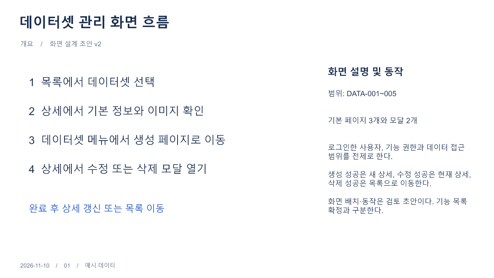
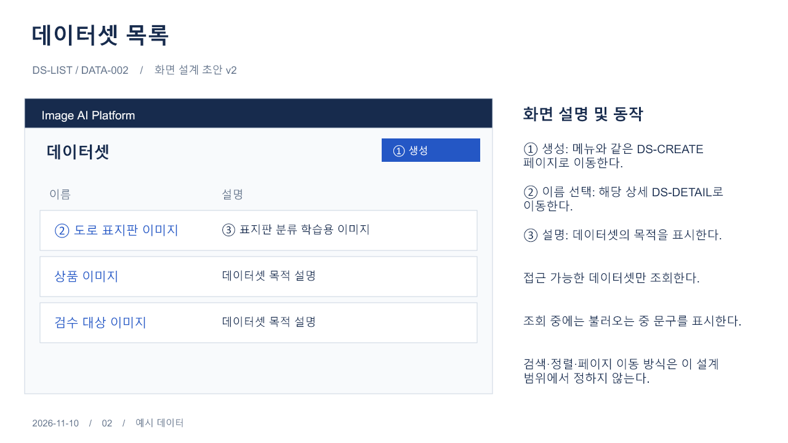
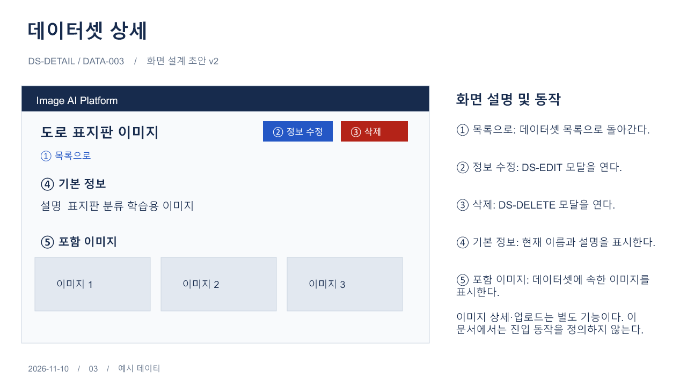
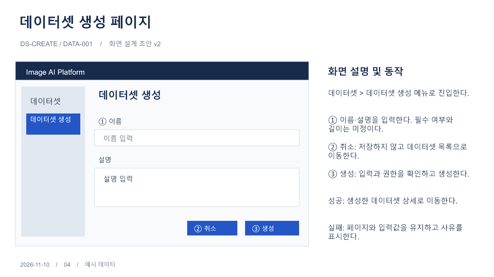
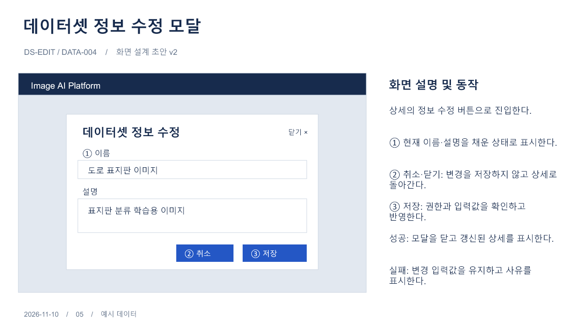
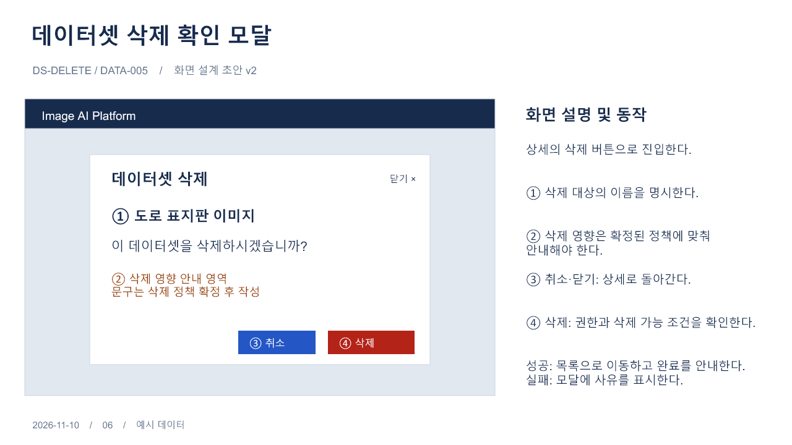
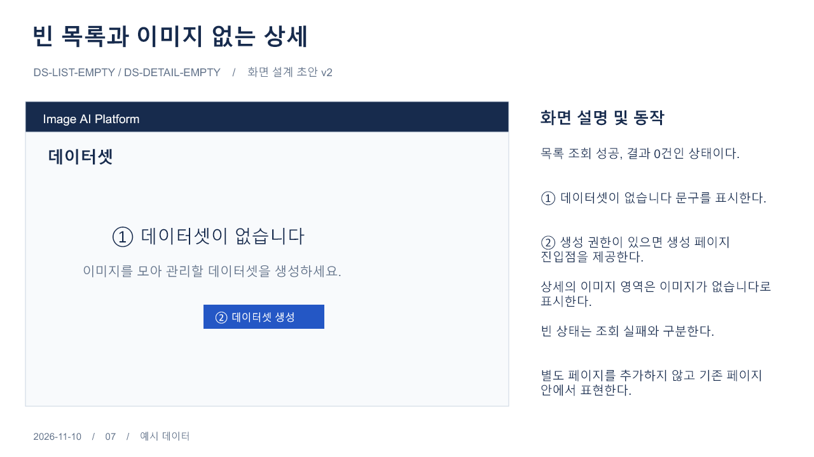
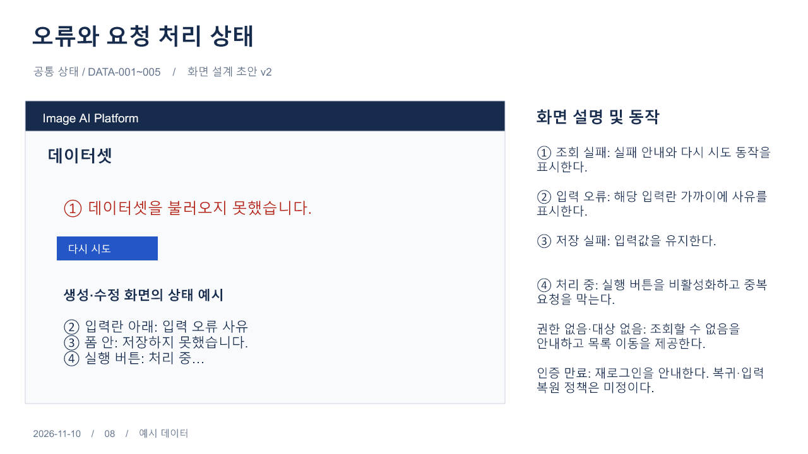
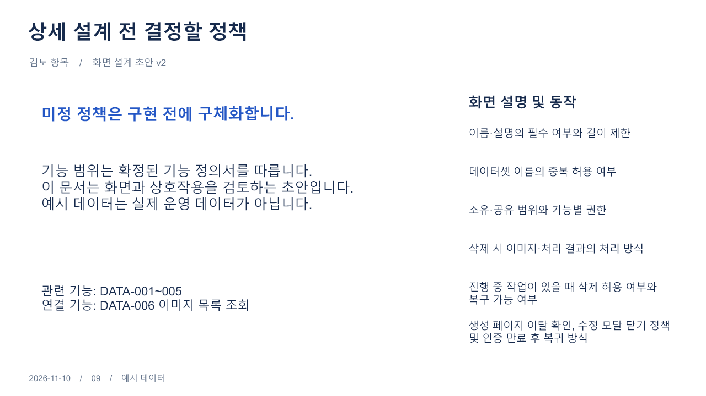

# 데이터셋 관리 화면 스토리보드

2026-11-13: 목록의 워크스페이스 다음에 「이미지 개수」 컬럼을 추가했습니다. 해당 데이터셋에 등록된 이미지 메타데이터 수를 표시하고 없으면 0개입니다. 썸네일은 중복 계산하지 않으며 실제 디스크 파일 수와 구분합니다. [API](../../api/api.md#데이터셋-목록)를 따릅니다.

2026-11-13: 목록 행의 우클릭 메뉴에 데이터셋 이름·워크스페이스·ID와 「이미지 관리」·「상세보기」를 추가했습니다. 이미지 관리는 해당 데이터셋이 선택된 독립 페이지로 이동하며 상세보기는 기존 모달을 엽니다. [이미지 관리](../image-management/README.md)와 [프런트 구현 기록](../../plans/front/design.md#이미지-목록데이터셋-우클릭-메뉴--2026-11-13)을 따릅니다.

컬럼 조절(2026-11-12): 제목의 내부 경계를 드래그하면 양옆 컬럼 너비가 조절되고 표 전체 폭은 유지됩니다. 마지막 컬럼 오른쪽은 드래그하지 못하며 내부 경계에만 핸들을 제공합니다. 창 변경 시 조절 비율을 유지합니다. [프런트 구현 기록](../../plans/front/design.md#컬럼-경계-드래그--2026-11-12)을 따릅니다.

목록 가로 크기(2026-11-12 후속): 최대 너비 제한 없이 창의 가용 폭을 채우고 표·생성 버튼·선택 삭제 버튼의 오른쪽 정렬을 함께 맞춥니다. 넓은 창에서는 컬럼도 늘어나며 좁은 창에서는 표 내부 가로 스크롤을 사용합니다.

목록 높이(2026-11-12): 행이 적으면 실제 표 높이만 사용하고 가로 스크롤바를 마지막 행 바로 아래에 표시합니다. 행이 많으면 창의 남은 높이로 제한해 표 내부를 세로 스크롤합니다. 스크롤바를 항상 창 맨 아래에 고정하는 방식은 아닙니다. 창 높이 변경에도 적용되며 [프런트 기록](../../plans/front/design.md#목록-최대-높이와-스크롤--2026-11-12)에 구현·검증을 기록했습니다.

2026-11-12 현재 상세: 목록의 데이터셋 이름은 마우스 오버 시 포인터·밑줄을 표시하는 버튼입니다. 클릭하면 서버 상세 조회 후 메타데이터 모달을 표시하며 행 선택 체크박스에는 영향을 주지 않습니다. 로딩·접근 거부·재시도, 닫기·Escape를 지원합니다. 상세 권한과 활성 공간 멤버십이 모두 필요하며 이미지 영역은 후속입니다. [API 계약](../../api/api.md#데이터셋-상세)을 따릅니다.

현재 목록 삭제(2026-11-11 후속): 목록 첫 열에 개별·전체 선택 체크박스, 상단에 선택 개수·선택 삭제 버튼을 제공합니다. 기본 확인창에서 건수를 확인한 뒤 항목별 삭제하며, 성공 행만 제거하고 실패 행과 선택을 유지해 결과를 안내합니다. 권한 검사는 서버 삭제 계약을 따릅니다. 기존 상세 삭제 모달 이미지는 현재 목록 선택 삭제를 표현하는 이미지가 아닙니다. [프런트 구현 기록](../../plans/front/design.md#목록-행-선택삭제--2026-11-11)을 따릅니다.

최신 계약(2026-11-11 독립 생성 변경): 여러 공간 체크는 공간별 별도 ID의 데이터셋 생성입니다. 입력 안내·성공 생성 건수·목록 각 공간 행 표시를 [ADR-034](../../decisions/ADR-034-independent-dataset-creation.md)에 맞췄습니다. 아래 공유 데이터셋 단일 행 설명과 기존 이미지는 이전 이력이며 현재 UI 계약이 아닙니다.

현재 구현(2026-11-11): 목록 `/datasets`와 생성 `/datasets/new`를 제공합니다. 생성은 가입 승인된 활성 공간을 체크박스 드롭다운에서 여러 개 선택합니다. 성공 후 목록 링크를 제공하고 취소는 목록으로 이동합니다. 목록은 가입 공간 통합 조회이며 공유 데이터셋은 한 행, 접근 가능한 공간 이름만 표시합니다. 이 문단의 당시 상세·수정·삭제 미구현 상태는 위 최신 상세·목록 삭제 기록으로 대체하며 수정·워크스페이스 관리 화면은 후속입니다. 기존 v2 이미지·아래 과거 구현 기록은 이전 설계 이력이며 다중 공간 선택을 반영한 새 이미지가 아닙니다. 최신 흐름·검증은 [프런트 기록](../../plans/front/design.md)을 참고합니다.

상태: 화면 설계 v2 — 생성 페이지·메뉴 방식 확정, 세부 배치·정책 초안  
작성일: 2026-11-10  
기능 범위: DATA-001~005

## 문서 형식

최신 구현(2026-11-10): 생성 페이지의 POST /api/datasets 저장을 연결했습니다. 성공하면 생성 이름·ID를 표시하고 폼을 초기화하며 실패 시 입력을 유지합니다. 목록·상세는 미구현이므로 현재 취소는 시작 화면으로 이동합니다. 아래 화면만 구현한 문단은 저장 연동 이전 이력입니다. 생성 계약은 [ADR-030](../../decisions/ADR-030-dataset-creation-contract.md)을 따릅니다.

2026-11-10 구현 범위: 생성 메뉴·독립 페이지(`/datasets/new`)·이름·설명 입력 UI를 구현했습니다. 실제 저장은 사용자 지시로 후속 작업이며 생성 버튼은 비활성화합니다. 목록 화면이 아직 없으므로 현재 취소는 시작 화면으로 이동합니다. 아래 그림은 목표 흐름이며 전체 기능 완료를 뜻하지 않습니다. 현재 검증 결과는 [프런트 구현 기록](../../plans/front/design.md#데이터셋-생성-화면-구현--2026-11-10)을 참고합니다.

[편집용 PPTX](dataset-management-v2.pptx)를 원본으로 관리하고, 저장소에서 바로 검토할 수 있도록 화면별 PNG를 함께 보관합니다. PPTX는 화면 배치와 설명을 편집하기 쉬우며 PDF는 확정본 공유가 필요할 때 생성합니다. 현재 PDF는 생성하지 않았습니다.

확정된 [기능 정의서](../../product/functional-specification.md)를 바탕으로 작성한 화면 설계 초안입니다. 생성의 별도 페이지 전환과 데이터셋 > 데이터셋 생성 메뉴는 확정 사항입니다. 그 밖의 세부 배치·상호작용은 초안이며 구현 완료를 의미하지 않습니다. 표시된 데이터는 예시입니다.

## 화면 구성 및 이동

| 화면 ID | 형태 | 기능 | 진입 | 성공 또는 종료 후 이동 |
|---|---|---|---|---|
| DS-LIST | 페이지 | DATA-002 목록 조회 | 데이터셋 관리 진입 | 선택한 DS-DETAIL |
| DS-DETAIL | 페이지 | DATA-003 상세 조회 | 목록에서 데이터셋 선택 | 목록 또는 수정·삭제 모달 |
| DS-CREATE | 페이지 | DATA-001 생성 | 데이터셋 > 데이터셋 생성 메뉴 또는 목록의 생성 버튼 | 성공 시 새 상세, 취소 시 목록 |
| DS-EDIT | 모달 | DATA-004 정보 수정 | 상세의 정보 수정 버튼 | 성공 시 상세 갱신, 취소 시 기존 상세 |
| DS-DELETE | 모달 | DATA-005 삭제 | 상세의 삭제 버튼 | 성공 시 목록, 취소 시 상세 |

기본 페이지는 3개, 모달은 2개입니다. 빈 상태와 오류 상태는 기존 페이지 또는 모달 내부에 표시합니다. 로그인 및 기능별 권한·데이터 접근 범위를 전제로 하며 소유·공유 정책은 미정입니다.

## 화면별 스토리보드

### 1. 화면 흐름

생성의 기본 진입점은 데이터셋 대메뉴 아래 데이터셋 생성 메뉴입니다. 목록의 생성 버튼도 동일한 생성 페이지로 연결합니다. 수정·삭제는 상세에서 시작합니다. 생성과 수정은 이름·설명 폼을 공유할 수 있습니다.

### 2. 데이터셋 목록

접근 가능한 데이터셋의 이름과 설명을 표시합니다. 이름을 선택하면 상세로 이동하고 생성 버튼은 별도 생성 페이지로 이동합니다. 검색·정렬·페이지 이동 방식은 이 문서에서 정하지 않습니다.

### 3. 데이터셋 상세

기본 정보와 포함 이미지 영역을 표시합니다. 이미지 목록은 DATA-006과 연결되는 영역이며 이미지 상세·업로드의 화면과 동작은 별도 정의합니다.

### 4. 데이터셋 생성 페이지

데이터셋 > 데이터셋 생성 메뉴에서 별도 페이지로 이동해 이름과 설명을 입력합니다. 생성 성공 시 새 상세로 이동합니다. 실패 시 페이지와 입력을 유지하고 사유를 표시합니다. 취소는 저장 없이 데이터셋 목록으로 이동합니다. 입력 변경 후 이탈·뒤로가기 확인 정책과 구체 URL은 미정입니다.

입력 항목이 앞으로 추가될 수 있으므로 그림의 필드 수·폼 높이·버튼 좌표를 구현의 고정값으로 사용하지 않습니다. 입력 폼은 세로로 확장하고 페이지 스크롤을 사용하며, 필드가 늘어나도 생성·취소 버튼과 필드별 오류에 접근할 수 있게 합니다. 상세 구현 기준은 [작업계획서의 생성 입력 항목 확장 원칙](../../plans/dataset-development-plan.md#생성-입력-항목-확장-원칙--2026-11-10-확정)을 따릅니다.

### 5. 데이터셋 정보 수정 모달

기존 이름과 설명을 채워 표시합니다. 저장 성공 시 상세를 갱신하며 실패 시 변경 입력을 유지합니다. 취소·닫기는 변경을 저장하지 않고 상세로 돌아갑니다.

### 6. 데이터셋 삭제 확인 모달

삭제 대상 이름과 삭제 영향을 안내한 뒤 명시적 삭제 동작으로 요청합니다. 삭제 권한과 삭제 가능 조건을 확인하며 성공 시 목록으로 이동합니다. 실패 시 모달에 사유를 표시합니다. 영향 안내 영역은 정책 미정 표시이며 실제 서비스 문구는 정책 확정 후 작성합니다.

### 7. 빈 상태

목록 조회 결과가 0건이면 빈 상태를 표시하고 생성 권한이 있을 때 생성 버튼을 제공합니다. 상세의 포함 이미지가 없으면 해당 영역에 빈 상태를 표시합니다.

### 8. 오류 및 처리 상태

조회 중에는 로딩 문구를 표시하고 조회 실패에는 다시 시도를 제공합니다. 입력 오류는 입력란 가까이에 표시합니다. 저장 실패는 입력을 유지하고, 요청 중에는 실행 버튼을 비활성화합니다. 권한 없음·대상 없음에는 조회 불가 안내와 목록 이동을 제공합니다. 인증 만료에는 재로그인을 안내합니다.

### 9. 미정 정책

- 이름·설명의 필수 여부와 길이 제한, 이름 중복 허용 여부
- 데이터셋 소유·공유 범위와 기능별 권한
- 삭제 시 이미지·처리 결과의 처리 방식, 진행 중 작업의 삭제 제한, 복구 가능 여부
- 생성 페이지의 입력 변경 후 이탈·뒤로가기 처리와 수정 모달의 닫기·Escape·배경 클릭 처리
- 인증 만료 후 화면 복귀 및 입력 복원 방식

## 변경 이력

| 날짜 | 버전 | 내용 |
|---|---|---|
| 2026-11-10 | v1 | 페이지 2개·모달 3개와 공통 상태를 포함한 9장 화면 설계 초안 작성 |
| 2026-11-10 | v2 | 확장성을 고려해 생성은 별도 페이지로 변경. 데이터셋 > 데이터셋 생성 메뉴를 기본 진입점으로 확정. 수정·삭제 모달 유지 |

이전 [v1 PPTX](dataset-management-v1.pptx)와 v1 이미지는 생성 모달 방식의 과거 설계 이력으로 보존합니다. 결정 근거는 [ADR-029](../../decisions/ADR-029-dataset-creation-page.md)를 참고합니다.
