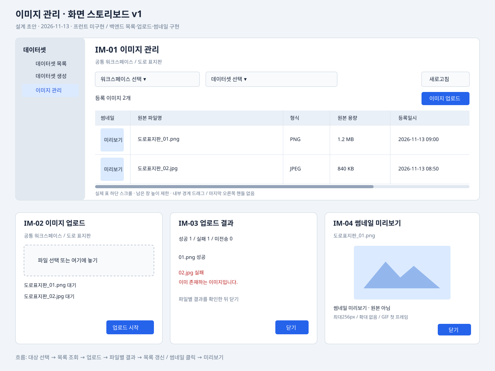

# 이미지 관리 화면 스토리보드

- 종류: 화면 설계 v1
- 상태: 목록·우클릭 진입·일반/수정 업로드·원본 상세 모달 구현. 결과는 업로드 모달 안에 표시
- 기준일: 2026-11-13
- 범위: 이미지 목록 독립 페이지, 업로드·결과·썸네일 미리보기 모달
- 기준: [공통 화면·그리드](../../plans/front/design.md), [현재 API](../../api/api.md#데이터셋-이미지-업로드), [썸네일 결정](../../decisions/ADR-038-image-thumbnails.md)

## 화면 구성과 이동

2026-11-13 권한 분리: 대상 선택 목록은 이미지 read 권한의 GET /api/datasets/image-targets를 사용합니다. dataset:item:read 없이 이미지 화면을 사용할 수 있습니다. 신규 업로드는 upload, 수정 업로드는 update이며 수정 모드의 이름 미일치 신규 등록에는 upload도 필요합니다. 개별 이미지 delete는 카탈로그만 있고 화면·API는 후속입니다. [현재 권한 계약](../../api/api.md#이미지-기능-권한)을 따릅니다.

2026-11-13 최신 구현: 이미지 목록에 등록자·수정자·수정일시를 추가하고 수정 업로드와 원본 상세를 구현했습니다. 기존 「썸네일 전용 미리보기」 제안은 원본 상세 모달로 변경했습니다. 아래 초기 업로드 취소·확대 미구현 기록과 SVG는 이전 설계 이력이며 최신 동작은 이 문서의 갱신된 항목과 [프런트 기록](../../plans/front/design.md#이미지-수정-업로드감사-컬럼원본-상세--2026-11-13)을 따릅니다.

2026-11-13 후속 구현: 사용자 요청으로 업로드 버튼·모달을 구현했습니다. IM-02 파일 선택·순차 전송과 IM-03 결과를 하나의 모달에 통합했습니다. 목록의 업로드 버튼은 데이터셋 선택 시 활성화하고 권한은 서버에서 최종 확인합니다. 아래 canUpload 기반 버튼 판정은 제안이며 현재 API 확장 범위에 포함하지 않았습니다. 상세는 [프런트 기록](../../plans/front/design.md#이미지-업로드-버튼모달--2026-11-13)을 따릅니다. 앞선 업로드 UI 취소 기록은 이번 사용자 지시로 재개되었습니다.

2026-11-13 구현: 사용자 지시에 따라 목록 페이지와 「데이터셋 목록으로」 버튼을 구현했습니다. 데이터셋 목록 행 우클릭 시 이름·워크스페이스·ID가 있는 메뉴에서 「이미지 관리」·「상세보기」를 선택합니다. 아래 상세 모달의 이동 버튼 제안은 미구현이며 현재는 행 우클릭 메뉴로 진입합니다. 썸네일은 목록에서만 표시하고 확대 모달·업로드는 후속입니다. 검증 범위는 [프런트 구현 기록](../../plans/front/design.md#이미지-목록데이터셋-우클릭-메뉴--2026-11-13)을 따릅니다. 아래 SVG는 전체 제안 범위를 보여주는 초안이며 현재 화면 캡처가 아닙니다.

데이터셋 대메뉴 아래 **이미지 관리** 중메뉴를 제안합니다. 가입 워크스페이스와 데이터셋을 선택한 뒤 해당 데이터셋의 이미지를 관리합니다. 데이터셋 목록의 상세 모달에도 「이미지 관리」 이동 버튼을 제안하며, 이 경로는 해당 데이터셋을 미리 선택합니다. 기존 상세 모달 자체는 변경하지 않습니다.

현재 경로는 `/datasets/images`이며 선택한 데이터셋은 `datasetId` 쿼리로 표현합니다. URL은 서버 접근 권한을 대신하지 않습니다. 페이지는 본문 가용 폭 전체를 사용하고 워크스페이스·데이터셋 선택 영역과 표·우측 버튼이 함께 늘어납니다.

현재 화면은 독립 페이지 1개와 모달 2개(업로드·결과 통합, 원본 상세)입니다. 수정 업로드는 같은 모달의 별도 모드입니다. 초기 SVG의 모달 3개 구성은 통합 전 초안입니다. 이미지 삭제·이동·이름 변경·별도 다운로드 버튼은 제공하지 않습니다.

## IM-01 이미지 목록 페이지

| 번호 | 요소 | 표시·동작 |
|---|---|---|
| 1 | 메뉴 | 데이터셋 → 이미지 관리. 중메뉴 들여쓰기 32px·14px, 기존 선택 강조 적용 |
| 2 | 제목 | 이미지 관리. 선택 데이터셋 이름·워크스페이스를 함께 표시 |
| 3 | 워크스페이스 | 가입한 활성 공간 중 단일 선택. 미선택 안내를 기본으로 하며 첫 공간을 임의로 확정하지 않음 |
| 4 | 데이터셋 | 선택 공간에 속한 데이터셋 중 단일 선택. 동명 항목은 식별용 ID를 함께 표시 |
| 5 | 조회·새로고침 | 두 선택이 완료되면 자동 조회. 새로고침은 현재 대상 재조회 |
| 6 | 업로드·수정 업로드 | 우측 정렬. 데이터셋 선택 시 활성화. 수정 업로드는 덮어쓰기 확인 후 모달 열기. 권한은 서버 최종 판정 |
| 7 | 목록 표 | 썸네일, 원본 파일명, 형식, 원본 용량, 등록자, 등록일시, 수정자, 수정일시 순서. 활성 버전만 최신 등록순 |
| 8 | 썸네일 | 64×64 표시 영역에서 비율 유지. 클릭 또는 키보드로 IM-04 열기. 미생성·불러오기 실패를 구분 |

등록자·수정자는 현재 버전의 로그인 ID·실명을 두 줄로 표시합니다. 없는 정보는 `-`이며 내부 createdBy·updatedBy를 로그인 ID처럼 표시하지 않습니다. 정렬·검색·페이지네이션 API는 현재 없으므로 해당 컨트롤은 배치하지 않습니다.

표는 공통 그리드와 동일하게 남은 창 높이 안에서 내부 세로 스크롤하고 가로 스크롤바를 실제 표 영역 바로 아래에 둡니다. 행이 적으면 표 높이도 줄입니다. 가용 폭을 채우며 좁은 창에서는 내부 가로 스크롤을 사용합니다. 내부 컬럼 경계는 드래그 조절하고 마지막 수정일시 컬럼 오른쪽에는 핸들을 두지 않습니다.

공간 변경 시 데이터셋·이미지·이전 오류를 초기화합니다. 데이터셋 변경 시 이전 목록을 즉시 비우며 늦게 도착한 이전 응답이 새 대상에 표시되지 않도록 합니다. 활성 요청 중 대상 변경은 업로드 모달에서 제한합니다.

## IM-02 업로드 모달

수정 업로드는 먼저 「기존 파일을 덮어씁니다.」 확인창을 표시합니다. 취소하면 모달·요청이 없고 확인하면 같은 모달의 제목을 「이미지 수정 업로드」로 표시합니다. 모달 내부에도 경고와 기존 기록·파일 보관, 동일 원본명 새 버전 교체, 이름 미일치 시 신규 등록을 안내합니다. 수정 모드는 replaceExisting=true로 요청하며 일반 모드는 중복 거부를 유지합니다.

대상 공간·데이터셋 이름을 상단에 고정 표시하고 파일 선택 버튼과 드롭 영역을 제공합니다. 파일 목록에는 원본 파일명·용량·상태를 표시합니다. 여러 파일을 선택할 수 있지만 실제 요청은 기존 단건 API를 **순차 호출**합니다. 선택만으로 전송하지 않으며 「업로드 시작」에서 전송합니다.

- 안내: PNG·JPEG·GIF·BMP, 기본 파일당 10MB. 실제 허용 용량은 서버 설정에 따릅니다. 썸네일은 자동 생성됩니다.
- 시작 전: 목록에서 파일 제거·다시 선택 가능. 빈 목록이면 시작 불가.
- 진행 중: 현재 파일과 전체 진행 건수 표시. 재시작·닫기·Escape·배경 클릭을 막아 결과 누락을 방지. 서버 요청 자동 재시도 없음.
- 파일별 실패: 해당 파일을 실패로 표시한 후 다음 파일 진행. 동일 선택 목록 안의 동명 파일도 서버의 데이터셋 내 중복 판정을 최종 기준으로 사용.
- 인증 만료: 나머지 파일 전송 중단, 미전송 상태 보존. 재로그인 후 결과와 대상 접근 권한을 다시 확인.
- 완료: IM-03 결과로 전환하고 원래 목록을 재조회. 전부 실패해도 성공 메시지를 표시하지 않음.

별도 일괄 API·일괄 트랜잭션은 필요하지 않습니다. 원본명 중복 409는 「이미 존재하는 이미지입니다」로 안내합니다. 400은 형식·파일 검증 실패, 413은 용량 제한, 403은 업로드 권한 없음으로 표시합니다. 통신 단절·500은 결과를 확정할 수 없음을 안내하고 목록 확인을 우선합니다.

## IM-03 업로드 결과 영역

IM-02 안에 「성공 N / 실패 N / 미전송 N」과 파일명·상태·실패 사유를 목록으로 표시합니다. 파일 목록 높이는 모달 안에서 제한하고 내부 스크롤합니다. 닫기 버튼으로 갱신한 이미지 목록에 복귀합니다. 성공 파일의 재전송은 제공하지 않으며 실패 파일을 다시 업로드하려면 사용자가 파일을 재선택합니다. 브라우저 새로고침 이후 전송 결과 화면은 보존하지 않지만 서버의 버전·작업 이력은 별도 DB 테이블에 보존합니다.

## IM-04 원본 이미지 상세 모달

썸네일 또는 원본명 클릭 시 제목 「이미지 상세」와 원본명·현재 버전·형식·원본 용량을 표시합니다. 본문에는 썸네일 대신 인증된 content API의 원본 이미지를 불러옵니다. 모달 최대 폭 1100px, 이미지 높이 60dvh 이내에서 비율을 유지합니다. 이미지 확인 목적의 모달 너비 예외이며 독립 목록 페이지는 가용 폭을 채웁니다. 로딩·권한/미존재/통신 오류와 재시도를 표시합니다.

닫기·Escape·배경 클릭으로 복귀하며 열었던 썸네일 버튼으로 포커스를 돌립니다. 인증 헤더를 넣어 조회한 이미지 바이트를 표시하고 모달 종료·대상 변경 시 표시 자원을 해제합니다. URL만 img src에 넣는 공개 이미지 방식은 사용하지 않습니다.

## 상태별 표시

| 상태 | 사용자 표시·동작 |
|---|---|
| 공간 없음 | 가입한 워크스페이스가 없습니다. 데이터셋·업로드 비활성 |
| 데이터셋 미선택 | 데이터셋을 선택해 주세요. 이미지 요청 없음 |
| 데이터셋 없음 | 이 워크스페이스에 데이터셋이 없습니다 |
| 목록 로딩 | 표 영역 로딩 표시, 업로드 중복 실행 제한 |
| 빈 목록 | 등록된 이미지가 없습니다. 허용 사용자에게 업로드 버튼 제공 |
| 목록 실패 | 오류와 재시도. 기존 성공 목록으로 오인할 행은 표시하지 않음 |
| 썸네일 URL null | 썸네일 없음. 원본명을 클릭해 원본 상세 확인 가능 |
| 썸네일 404 | 미리보기 없음. 다른 행은 계속 표시 |
| 썸네일 통신 오류 | 불러오기 실패와 해당 이미지 재시도 |
| 접근 거부 403 | 권한이 없거나 접근 가능한 대상이 아닙니다. 업로드 중지·목록 재확인 |
| 인증 오류 401 | 기존 로그인 전환 정책 사용. 이전 계정의 이미지 바이트·목록 제거 |

## 현재 구현과 선행 작업

| 구분 | 상태 |
|---|---|
| 가입 공간·이미지 관리 대상 조회 | 백엔드 구현. 이미지 read 전용 대상 목록을 프런트에서 공간별 필터 |
| 이미지 목록·단건 업로드·권한 있는 썸네일 조회 | 백엔드 구현. 계약 상세는 API 기준 문서 참고 |
| 업로드 버튼의 정확한 범위 표시 | **추가 계약 필요**. 현재 응답에 대상별 canUpload가 없어 UI가 운영자/생성자 조건을 확정할 수 없음. 서버 판정 결과 제공 방식을 구현 전에 결정 |
| 메뉴·목록 페이지·프런트 조회 연동 | 2026-11-13 구현 |
| 업로드·결과 | 업로드 모달에 통합 구현 |
| 원본 상세 모달 | 썸네일·원본명 클릭으로 구현 |
| 기존 이미지 썸네일 소급 생성 | 미구현·이번 범위 제외 |

## 화면 구현 확인 기준

공간·데이터셋 전환 시 이미지가 섞이지 않고, 일반 읽기 사용자도 목록·썸네일을 볼 수 있어야 합니다. 업로드 권한은 서버가 최종 확인해야 합니다. 업로드 혼합 성공·중복 실패·통신 단절·인증 만료 상태를 구분하고, 창 크기 변경 시 표 높이·폭·스크롤·컬럼 조절이 공통 기준과 일치해야 합니다. 키보드로 대상 선택·업로드·모달 열기/닫기를 수행할 수 있어야 합니다. 이 항목은 향후 구현의 확인 기준이며 실행한 테스트 기록이 아닙니다.
